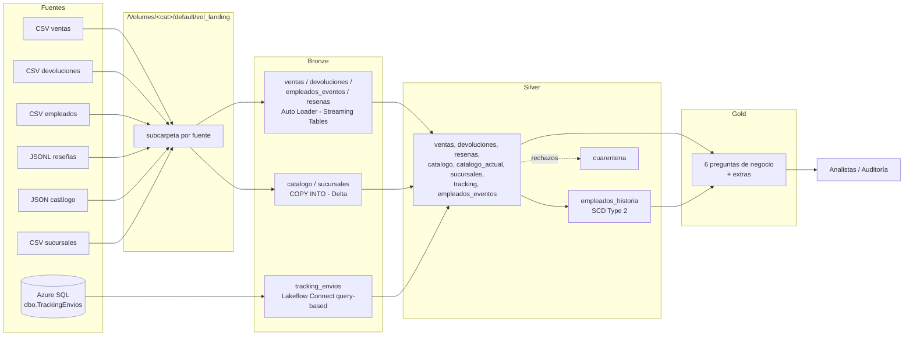
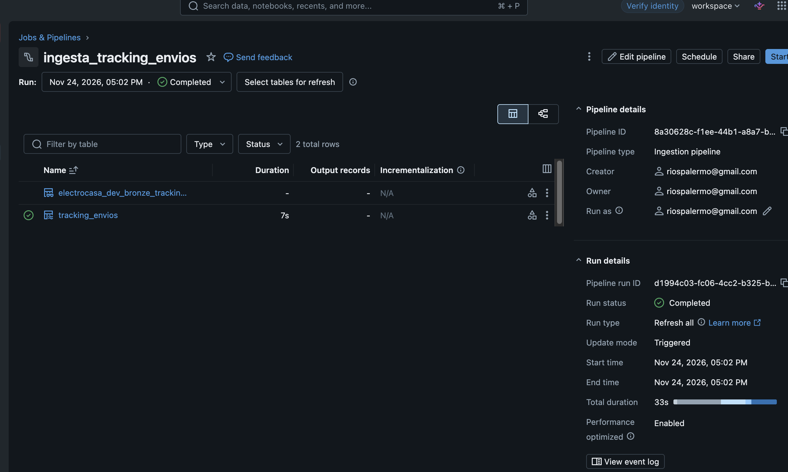
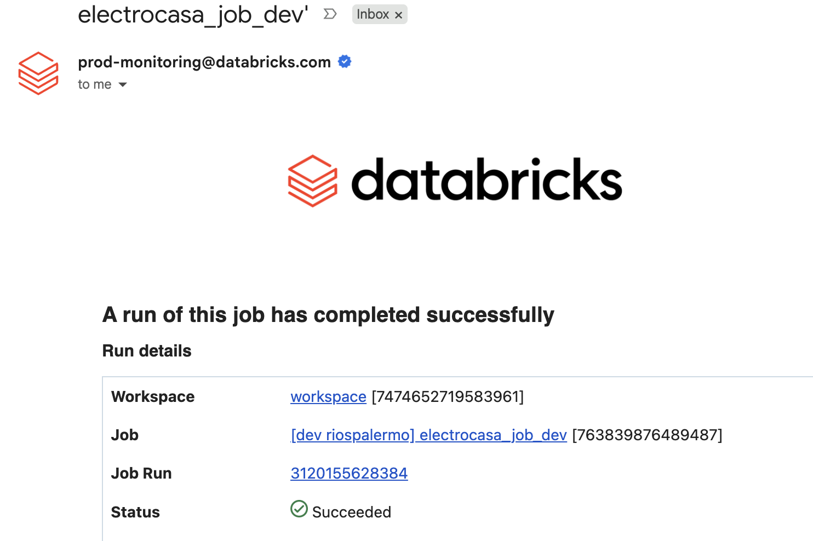
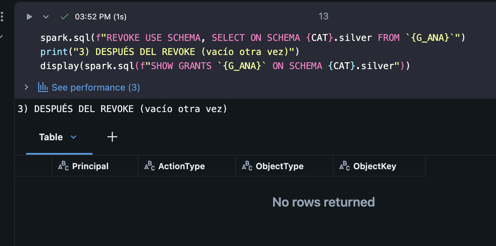
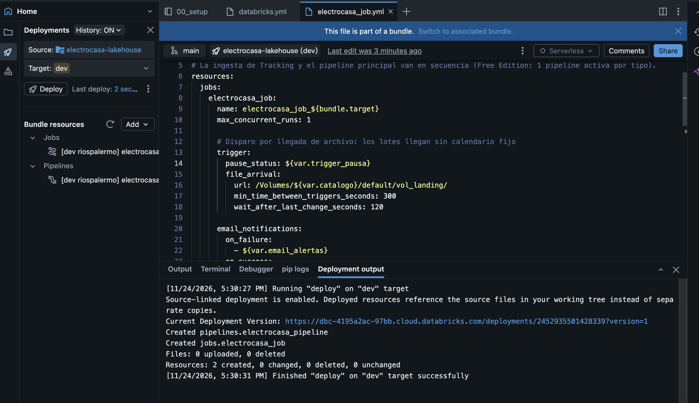
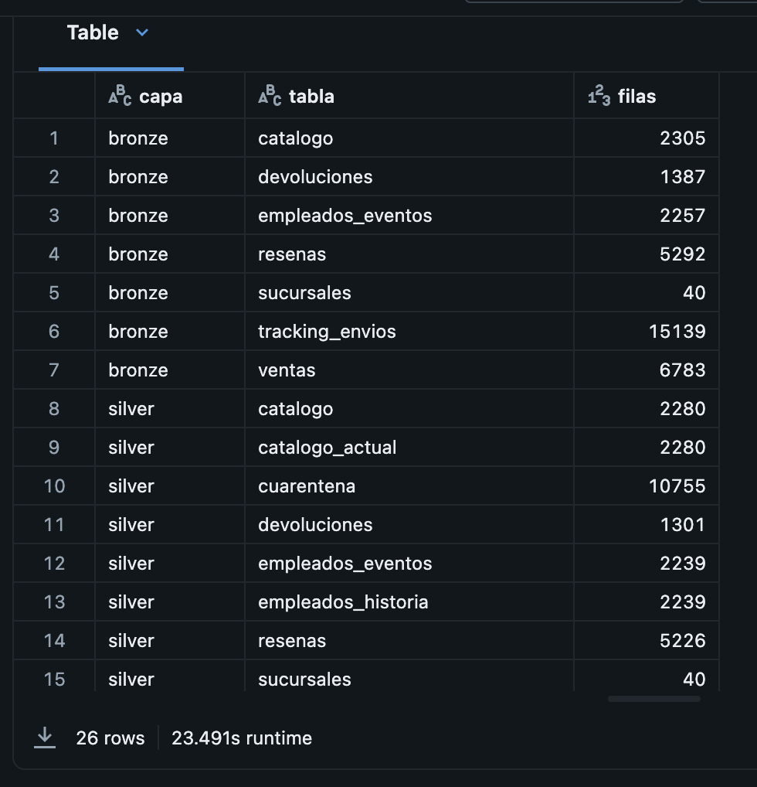
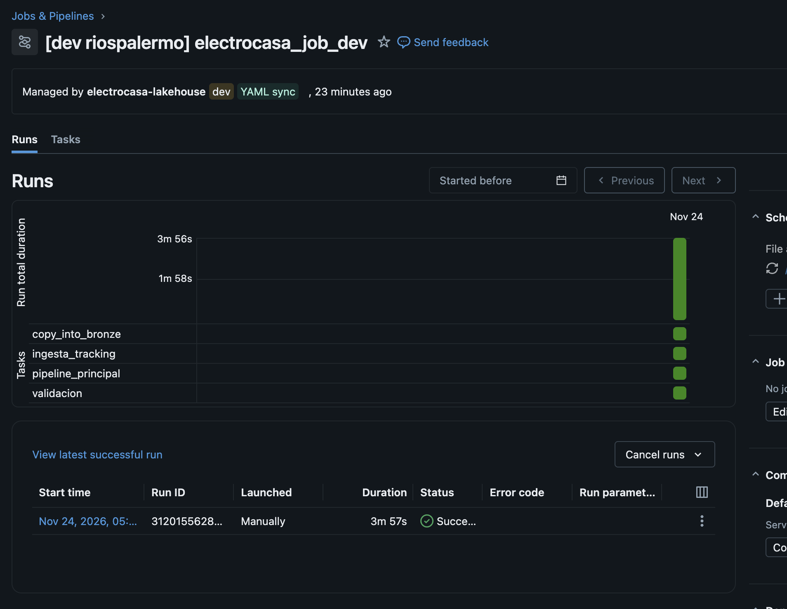
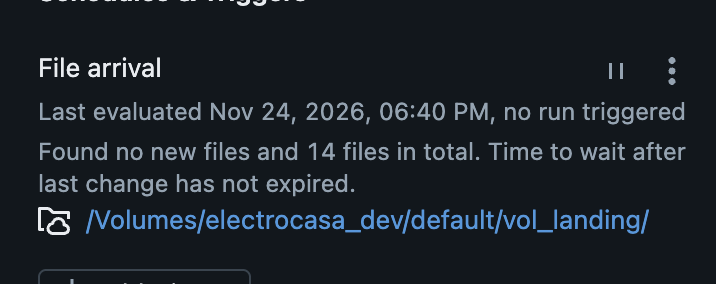

# ElectroCasa Lakehouse — Proyecto Integrador

Plataforma de datos sobre **Azure Databricks / Databricks Free Edition** para ElectroCasa, una cadena de 40 sucursales de electrodomésticos en Perú. Integra seis fuentes heterogéneas (ventas, catálogo, RR.HH., reseñas, devoluciones y tracking de envíos) y la tabla de referencia de sucursales en un modelo **Medallion** (Bronze → Silver → Gold) construido con **Lakeflow Spark Declarative Pipelines**, orquestado con **Lakeflow Jobs**, gobernado con **Unity Catalog** y desplegado con un **Declarative Automation Bundle**.

> Los datos, sucursales y personas son ficticios.

---

## 1. El caso

Hoy no hay una fuente única de verdad: cada sucursal exporta sus ventas por separado, RR.HH. registra eventos en su propio sistema, las reseñas se leen a mano y el tracking vive en la base del courier. La capa Gold responde seis preguntas de negocio (marzo a octubre de 2026):

| # | Pregunta | Tabla Gold |
|---|---|---|
| 1 | Ventas netas, cantidad de ventas y ticket promedio por sucursal y mes | `gold.ventas_netas_sucursal_mes` |
| 2 | Top 10 por unidades y top 10 por tasa de devolución | `gold.top_productos_unidades`, `gold.top_productos_tasa_devolucion` |
| 3 | Dotación activa por sucursal al cierre de cada mes | `gold.dotacion_sucursal_mes` |
| 4 | Ventas de tienda física por vendedor, sucursal del vendedor **en la fecha de la venta** y mes | `gold.ventas_vendedor_sucursal_mes` |
| 5 | % de reseñas negativas por categoría y mes | `gold.resenas_negativas_categoria_mes` |
| 6 | Horas promedio de entrega y % de devueltos por courier | `gold.despachos_courier` |
| extra | Reseñas negativas por origen (VARIANT) | `gold.resenas_negativas_por_origen` |
| extra | Versión actual de empleados con masking | `gold.empleados_vista` |

---

## 2. Arquitectura



**Orden del job:**

```
copy_into_bronze (notebook) ─┐
                             ├─► pipeline_principal (pipeline) ─► validacion (notebook)
ingesta_tracking (pipeline) ─┘
```

La ingesta de Tracking y el pipeline principal van **en secuencia** (en Free Edition solo puede haber una pipeline activa por tipo).

### Estructura del repositorio

```
electrocasa-lakehouse/
├── databricks.yml                       # bundle: variables y targets dev / prod
├── resources/
│   ├── electrocasa_pipeline.yml         # pipeline Lakeflow SDP (serverless)
│   └── electrocasa_job.yml              # job: tareas, dependencias, trigger, reintentos y alertas
├── src/electrocasa/
│   ├── config/fuentes.json              # ingesta por metadata (rutas, formato, schema, opciones)
│   ├── transformations/
│   │   ├── 01_bronze.py                 # Auto Loader dirigido por fuentes.json
│   │   ├── 02_silver_referencia.py      # sucursales, catálogo, catálogo actual
│   │   ├── 03_silver_ventas.py          # ventas y devoluciones
│   │   ├── 04_silver_empleados.py       # eventos + SCD2 (con MASK)
│   │   ├── 05_silver_resenas.py         # reseñas (VARIANT)
│   │   ├── 06_silver_tracking.py        # tracking sin reprocesados
│   │   ├── 07_silver_cuarentena.py      # rechazos consultables
│   │   └── 08_gold.py                   # preguntas de negocio
│   └── utils/
│       ├── config.py                    # carga de fuentes.json, período, rangos
│       ├── normalizacion.py             # fechas, decimales, mapeos a conjuntos cerrados
│       ├── reglas.py                    # reglas de calidad (fuente de verdad de pipeline y contratos)
│       └── calidad.py                   # expectativas por política + constructor de cuarentena
├── contratos/                           # un contrato de datos por fuente
├── notebooks/
│   ├── 00_setup.ipynb                   # catálogo, schemas, volume, máscaras, GRANT / REVOKE
│   ├── 01_copy_into.ipynb               # COPY INTO idempotente (catálogo, sucursales)
│   ├── 02_validacion.ipynb              # conteos, rechazos y falla si Gold está vacío
│   └── 03_monitoreo_y_evidencias.ipynb  # event log, system tables, masking, SCD2, VARIANT
└── img/                                 # capturas de evidencia
```

---

## 3. Ingesta

### 3.1 Método por fuente

| Fuente | Método | Tabla Bronze | Justificación |
|---|---|---|---|
| Ventas | **Auto Loader** | `bronze.ventas` (ST) | Lotes incrementales que solo agregan filas; Auto Loader recuerda qué archivos procesó y escala si el volumen crece. |
| Devoluciones | **Auto Loader** | `bronze.devoluciones` (ST) | Mismo patrón append incremental que ventas. |
| Empleados | **Auto Loader** | `bronze.empleados_eventos` (ST) | Son eventos (append puro), con llegadas tardías en lotes posteriores. |
| Reseñas | **Auto Loader** | `bronze.resenas` (ST) | JSON Lines anidado por lotes; schema explícito con arreglos y structs. |
| Catálogo | **COPY INTO** | `bronze.catalogo` (Delta) | Snapshot completo poco frecuente (marzo, agosto): una carga por archivo, idempotente, sin necesidad de un stream. |
| Sucursales | **COPY INTO** | `bronze.sucursales` (Delta) | Referencia de un solo archivo; COPY INTO no lo vuelve a cargar si se reejecuta. |
| Tracking | **Lakeflow Connect** (query-based SQL Server) | `bronze.tracking_envios` | Obligatorio. Cursor `fecha_modificacion`, PK `evento_id`. |

- **Schema explícito** en todos los CSV (todo como `STRING` en Bronze: los montos llegan con coma decimal y las fechas en varios formatos; la conversión es de Silver). No se usa `inferSchema`.
- **Columnas de auditoría** en Bronze: `_source_file` (`_metadata.file_name`), `_source_path`, `_file_modification_ts`, `_lote` e `_ingest_ts`.
- **Sin lógica de negocio en Bronze** y **sin particionar por fecha de negocio**.
- Auto Loader corre **dentro del pipeline**: el checkpoint y la ubicación del schema los administra el pipeline (no se configuran rutas a mano).
- **COPY INTO va fuera del pipeline** (tarea `copy_into_bronze` del job) y el pipeline lee esas tablas en batch desde Materialized Views.
- Catálogo con `multiLine` + `primitivesAsString` (evita `DELTA_FAILED_TO_MERGE_FIELDS` porque `activo` llega como booleano).

### 3.2 Tracking (Lakeflow Connect)

1. Connection de Unity Catalog tipo **SQL Server** (`Catalog > External data > Connections > Create connection`). La contraseña vive **solo** en la Connection.
2. Catálogo foráneo `electrocasa_sqlserver` (solo para explorar la tabla).
3. Ingesta query-based: tabla `dbo.TrackingEnvios`, **cursor `fecha_modificacion`**, **PK `evento_id`** (no `tracking_id`, que se repite por diseño), destino `electrocasa_dev.bronze.tracking_envios`, columnas seleccionadas: `evento_id, tracking_id, venta_id, courier, estado_entrega, sucursal_origen, fecha_actualizacion, fecha_modificacion`.
4. **Modo de historia: append only.** Cada fila es un evento inmutable; no hay nada que actualizar. Append conserva todos los eventos (incluidos los reprocesados) tal como llegaron, y la deduplicación se hace en Silver, donde es visible y auditable.

**Evidencia de las dos corridas** de la pipeline `ingesta_tracking_envios` (Ingestion pipeline, update mode *Triggered*):

| Corrida | Inicio | Duración de la tabla | Output records `tracking_envios` |
|---|---|---|---|
| 1 (carga inicial) | 24-nov-2026 16:45 | 4m 21s | **15K** (15.139 eventos) |
| 2 (sin cambios en la tabla) | 24-nov-2026 17:02 | 7s | **— (0 filas)** |

La segunda corrida no vuelve a traer filas: el conector guarda el último valor de `fecha_modificacion` leído y solo consulta los registros con un valor mayor. Eso demuestra que la ingesta es **incremental por cursor** y no una recarga completa.

**Corrida 1:** carga inicial


**Corrida 2:** sin filas nuevas



`DESCRIBE HISTORY electrocasa_dev.bronze.tracking_envios` y conteo de la tabla:

| version | timestamp (UTC) | operation |
|---|---|---|
| 2 | 2026-11-24 21:50:14 | **STREAMING UPDATE**: carga inicial de los 15.139 eventos (corrida 1) |
| 1 | 2026-11-24 21:45:51 | DLT SETUP |
| 0 | 2026-11-24 21:45:49 | CREATE TABLE |

```
SELECT count(*) AS eventos FROM electrocasa_dev.bronze.tracking_envios;  -->  15139
```

- La **corrida 2** (22:02 UTC) **no generó ninguna versión nueva**: la última sigue siendo la 2. La tabla mantiene los 15.139 eventos, sin duplicados.
- La operación de la carga es `STREAMING UPDATE` y no `MERGE`, lo que confirma que el conector quedó en modo **append only**.


---

## 4. Silver: limpieza, estandarización, deduplicación y calidad

Silver se implementa con **Materialized Views** sobre Bronze. Al recalcularse con todos los lotes, la deduplicación de reingestas es exacta y los eventos tardíos de Empleados quedan en su lugar sin lógica extra.

| Normalización | Cómo |
|---|---|
| Fechas en varios formatos → `DATE`/`TIMESTAMP` | `coalesce` de `try_to_timestamp` con cada formato (no falla con ANSI) |
| `1.234,50` y `S/ 1,299.90` → `DECIMAL(12,2)` | detección de coma decimal vs. coma de miles (`utils/normalizacion.py`) |
| Métodos de pago, categorías, tipos de evento, estados, canal | mapeo por expresión regular a conjuntos cerrados |
| Courier | conjunto cerrado: `Olva Courier` (incluye "Olva"), `Shalom` y `Servientrega` |
| `ciudad` en sucursales | `initcap(lower(trim))` |
| Reingestas | ventas por `venta_id`, devoluciones por `devolucion_id`, reseñas por `resena_id` (queda la primera que llegó) |
| Productos repetidos en marzo | uno por producto y snapshot (precio válido y mayor) |
| Reprocesados de tracking | mismo `tracking_id` + estado + `fecha_actualizacion` → queda el de menor `fecha_modificacion` |

### 4.1 Expectativas de calidad y políticas

Las reglas viven en `src/electrocasa/utils/reglas.py`; el pipeline (`dp.expect_all`, `expect_all_or_drop`, `expect_all_or_fail`) y los contratos se generan desde ahí, así **el contrato coincide con el código**.

| Fuente | Regla | Política | Por qué |
|---|---|---|---|
| Sucursales | `sucursal_id` no nulo | **fail** | Es la dimensión que une ventas, devoluciones, dotación y vendedores; sin ella todo Gold sería incorrecto. Es un archivo de referencia chico: mejor detener y corregir. |
| Ventas | `venta_id`, `fecha_venta`, `sucursal_id` presentes; `monto_total > 0`; `cantidad > 0`; canal válido | **drop** | Sin ellos la venta no se puede asignar a sucursal/mes ni sumar (P1, P2, P4). Se descarta la fila, no todo el lote. |
| Ventas | producto en catálogo, método de pago conocido, vendedor en tienda física | warn | La venta ocurrió: excluirla distorsionaría las ventas netas. |
| Catálogo | `producto_id` presente | drop | Sin llave no hay producto. |
| Catálogo | `precio_lista` numérico > 0, categoría válida, marca presente | warn | Ninguna pregunta usa el precio; descartar el producto haría que sus reseñas se excluyan como "producto inexistente". |
| Empleados | `id_empleado` y `fecha_evento` no nulos; `tipo_evento` válido | **drop** | Sin ellos no se puede ubicar el evento en la historia. Un `NOT NULL` en el schema no lo impide: lo frena la expectativa. |
| Empleados | salario en rango (500–30 000), dni único, dni presente | warn | No afectan dotación ni ventas por vendedor. |
| Reseñas | `calificacion` entera entre 1 y 5; `resena_id` y `fecha_resena` presentes | **drop** | P5 se calcula sobre la calificación. |
| Reseñas | producto en catálogo, comentario presente | warn | La reseña es válida; P5 excluye los productos inexistentes con un `INNER JOIN`. |
| Devoluciones | venta existe; `0 <= monto_reembolso <= monto de la venta`; fecha y sucursal presentes | **drop** | La regla se evalúa sobre la vista con el join a ventas. Un reembolso inválido restaría ventas netas que no existen. |
| Tracking | estado dentro de {pendiente, en_transito, entregado, devuelto}; `tracking_id` y `fecha_modificacion` presentes | **drop** | P6 se basa en el estado y el tiempo entre estados. |
| Tracking | venta existe, `fecha_actualizacion` presente | warn | El tiempo de entrega del courier sigue siendo válido. |

### 4.2 Cuarentena consultable (`silver.cuarentena`)

Una fila por registro y regla violada, con **fuente, regla, condición, política, id del registro, lote, archivo de origen, fecha de ingesta, fecha de proceso y el registro completo en JSON** (sin `dni`/`salario`/`email`). `politica = 'drop'` son los rechazados; `politica = 'warn'` quedan en Silver pero registrados. La tabla se recalcula desde Bronze en cada corrida, así que **corregir un mapeo o una regla reprocesa automáticamente** los registros.

```sql
SELECT fuente, regla, politica, count(*) FROM electrocasa_dev.silver.cuarentena GROUP BY ALL;
```

### 4.3 Historización de Empleados (SCD Type 2)

Implementado **armando los intervalos sobre la tabla de eventos** (`silver.empleados_historia`, Materialized View), en lugar de `AUTO CDC`:

- Cada evento válido genera una versión. Orden: **`fecha_evento`** (cuándo ocurrió) y **`fecha_registro`** (cuándo lo cargó RR.HH.) para desempatar dos eventos del mismo día. Nunca `current_timestamp()`.
- `vigente_desde = fecha_evento`, `vigente_hasta = fecha del evento siguiente` (exclusivo), `NULL` = versión actual.
- Los atributos que un evento no trae (p. ej. el salario en una transferencia) se arrastran de la versión anterior (`last(..., ignorenulls)`).
- `estado`: `ACTIVO` desde un ALTA, `CESADO` desde una BAJA/cese, `SIN_ALTA` si no hay alta.
- **Eventos tardíos:** como la vista se recalcula con todos los eventos, un evento de junio que llega en el lote 3 se ubica en su lugar y reabre/cierra los intervalos correctos.
- **Por qué no `AUTO CDC`:** con eventos tardíos y empates en el mismo día, la historia completa recalculada es determinista y fácil de auditar; el orden sale igual de los datos de la fuente.

**Evidencia: empleado con eventos tardíos** (`EMP-00286`, salida de `03_monitoreo`, sección 7):

| versión | tipo_evento | sucursal | fecha_evento | fecha_registro | vigente_desde | vigente_hasta | actual |
|---|---|---|---|---|---|---|---|
| 1 | ALTA | S04 | 2024-10-26 | 2026-03-01 | 2024-10-26 | 2026-04-20 | no |
| 2 | TRANSFERENCIA | S32 | 2026-04-20 | 2026-04-24 | 2026-04-20 | 2026-06-08 | no |
| 3 | TRANSFERENCIA | S39 | 2026-06-08 | 2026-06-08 | 2026-06-08 | 2026-08-24 | no |
| 4 | TRANSFERENCIA | **S06** | **2026-08-24** | **2026-10-11** | 2026-08-24 | 2026-09-25 | no |
| 5 | TRANSFERENCIA | S22 | 2026-09-25 | 2026-09-27 | 2026-09-25 | — | **sí** |

La transferencia a S06 del 24-ago la cargó RR.HH. el 11-oct y llegó en el **lote 3**. Aun así quedó como versión 4, **entre** la de junio y la de septiembre, y cerró correctamente el intervalo anterior. Con eso, al cierre de agosto (P3) este empleado cuenta en S06, no en S39.

Uso en Gold: un empleado está activo en la fecha *d* si `estado = 'ACTIVO' AND vigente_desde <= d AND (vigente_hasta IS NULL OR vigente_hasta > d)`. Una baja en *d* lo deja inactivo ese día. En P4, si no hay versión activa en la fecha de la venta → `SIN_ASIGNAR`.

### 4.4 Decisiones

| Decisión | Elección | Justificación |
|---|---|---|
| Ventas con producto inexistente | Se conservan (warn, `producto_en_catalogo = false`) | La venta ocurrió; excluirla subestima P1. |
| Reseñas con producto inexistente | Se conservan en Silver (warn) y P5 las excluye | Lo pide la pregunta; Silver no pierde información. |
| Devoluciones con venta inexistente | Se descartan (drop → cuarentena) | No se puede validar el reembolso contra la venta ni asegurar a qué venta resta. |
| Tracking con venta inexistente | Se conserva (warn) | El tiempo del courier es válido igual. |
| Mismo `dni` en dos empleados | Se conservan ambos, marcados `dni_duplicado` (warn) | La llave es `id_empleado`; el dni no participa en ninguna pregunta. |
| Salarios fuera de rango | Se conservan, marcados `salario_en_rango = false` (warn) | No afectan las preguntas; corregirlos requiere a RR.HH. |
| Máscara de `dni` | Últimos 3 dígitos visibles (`*****678`) | Permite verificación parcial sin exponer el documento. |
| Máscara de `salario` | `NULL` | La función debe devolver `DECIMAL(12,2)`; no admite `***`. |
| Conector de Tracking | Append only | Eventos inmutables; la dedup se hace en Silver. |
| Productos descontinuados | Se conservan con `activo = false` | Ventas y reseñas históricas los referencian. |
| Auto Loader vs COPY INTO | Auto Loader: ventas, devoluciones, empleados, reseñas. COPY INTO: catálogo, sucursales | Ver 3.1. |

---

## 5. Gold

Las siete tablas Gold se calculan sobre Silver, filtrando el período 2026-03-01 a 2026-10-31:

- **P1:** ventas por `fecha_venta` y devoluciones por `fecha_devolucion` se agregan **por separado** y se unen con `FULL OUTER JOIN` (un mes con devoluciones y sin ventas también aparece). Ticket = ventas sin restar devoluciones / `COUNT(DISTINCT venta_id)`.
- **P2:** unidades = `SUM(cantidad)`; tasa = `COUNT(DISTINCT devolucion_id)` / `COUNT(DISTINCT venta_id)` del producto.
- **P3:** calendario de cierres de mes × historia SCD2; incluye sucursales con 0 empleados.
- **P4:** solo `tienda_fisica`, join por rango de vigencia; sin versión vigente → `SIN_ASIGNAR`.
- **P5:** categoría del **último snapshot** (`silver.catalogo_actual`); `INNER JOIN` excluye productos inexistentes; Silver ya excluye calificaciones inválidas.
- **P6:** primer `pendiente` y primer `entregado` por envío (`fecha_modificacion`); % devueltos = envíos con `devuelto` / envíos con estado final.

---

## 6. Orquestación (Lakeflow Jobs)

`resources/electrocasa_job.yml`:

| Tarea | Tipo | Depende de | Reintentos |
|---|---|---|---|
| `copy_into_bronze` | notebook | — | 2 (1 min) |
| `ingesta_tracking` | pipeline (conector) | — | 2 (2 min) |
| `pipeline_principal` | pipeline | ambas anteriores | 1 |
| `validacion` | notebook | `pipeline_principal` | 0 (si falla es que hay un problema real de datos) |

- **Trigger: llegada de archivo** sobre `/Volumes/<catalogo>/default/vol_landing/`. Los lotes llegan sin calendario fijo; correr por horario gastaría cuota sin datos nuevos. `min_time_between_triggers_seconds: 300` y `wait_after_last_change_seconds: 120` agrupan los archivos de un mismo lote en una corrida. El estado del trigger se controla con la variable `trigger_pausa` (`pause_status` explícito en el job): `UNPAUSED` en `dev` y `PAUSED` en `prod` para no consumir la cuota de Free Edition.
- **Alertas:** correo en fallo y en éxito (`email_alertas`). Evidencia: correo recibido tras la corrida del lote 1 (run `3120155628384`, *Succeeded*):

  
- `max_concurrent_runs: 1`: nunca dos pipelines a la vez.

### Compute

| Recurso | Compute | Justificación |
|---|---|---|
| Pipeline principal | Serverless, modo triggered (no continuo) | Corre una vez por lote, datos chicos (decenas de miles de filas); no tiene sentido un cluster encendido. Continuo en serverless está prohibido. |
| Conector Tracking | Serverless (lo administra Lakeflow Connect) | Ingesta incremental corta por cursor. |
| Notebooks del job (COPY INTO, validación) | Serverless jobs compute | Tareas cortas; arranque rápido; sin clusters all-purpose en el job productivo. |
| Consultas ad hoc / evidencias | SQL warehouse 2X-Small o serverless notebook | Interactivo y de bajo consumo. |

---

## 7. Gobierno y seguridad (Unity Catalog)

- Catálogos `electrocasa_dev` y `electrocasa_prod`; schemas `bronze`, `silver`, `gold`; volume `default.vol_landing`. Todas las tablas son **managed**.
- Grupos creados en **Settings > Identity and access > Groups** (no por API/SDK, que los crea como grupos locales y el `GRANT` falla con `PRINCIPAL_DOES_NOT_EXIST`).

| Grupo | Permisos (`notebooks/00_setup.ipynb`) |
|---|---|
| `electrocasa_ingenieria` | `USE CATALOG`; `USE SCHEMA, SELECT, MODIFY, CREATE TABLE, CREATE MATERIALIZED VIEW, CREATE FUNCTION, EXECUTE` en bronze/silver/gold; `READ/WRITE VOLUME` en landing |
| `electrocasa_analistas` | `USE CATALOG`; `USE SCHEMA, SELECT` en gold |
| `electrocasa_auditoria` | `USE CATALOG`; `USE SCHEMA, SELECT` en gold; system tables (ver abajo) |

**GRANT ejecutados contra los tres grupos** (salida de `00_setup`, sección 3, catálogo `electrocasa_dev`). Ninguno falló con `PRINCIPAL_DOES_NOT_EXIST`: Unity Catalog reconoce los grupos creados desde Settings.

```
OK  GRANT USE CATALOG ON CATALOG electrocasa_dev TO `electrocasa_ingenieria`
OK  GRANT USE SCHEMA, SELECT, MODIFY, CREATE TABLE, CREATE MATERIALIZED VIEW, CREATE FUNCTION, EXECUTE ON SCHEMA electrocasa_dev.bronze TO `electrocasa_ingenieria`
OK  GRANT USE SCHEMA, SELECT, MODIFY, CREATE TABLE, CREATE MATERIALIZED VIEW, CREATE FUNCTION, EXECUTE ON SCHEMA electrocasa_dev.silver TO `electrocasa_ingenieria`
OK  GRANT USE SCHEMA, SELECT, MODIFY, CREATE TABLE, CREATE MATERIALIZED VIEW, CREATE FUNCTION, EXECUTE ON SCHEMA electrocasa_dev.gold TO `electrocasa_ingenieria`
OK  GRANT USE SCHEMA ON SCHEMA electrocasa_dev.default TO `electrocasa_ingenieria`
OK  GRANT READ VOLUME, WRITE VOLUME ON VOLUME electrocasa_dev.default.vol_landing TO `electrocasa_ingenieria`
OK  GRANT USE CATALOG ON CATALOG electrocasa_dev TO `electrocasa_analistas`
OK  GRANT USE SCHEMA, SELECT ON SCHEMA electrocasa_dev.gold TO `electrocasa_analistas`
OK  GRANT USE CATALOG ON CATALOG electrocasa_dev TO `electrocasa_auditoria`
OK  GRANT USE SCHEMA, SELECT ON SCHEMA electrocasa_dev.gold TO `electrocasa_auditoria`
```

**Membresía del dueño del pipeline.** El usuario que despliega y es dueño del pipeline pertenece a `electrocasa_ingenieria` (y no a los otros dos grupos), y la máscara le devuelve el DNI completo:


**Demostración de REVOKE.** Se otorgó a `electrocasa_analistas` un privilegio que no le corresponde (`USE SCHEMA` + `SELECT` sobre `electrocasa_dev.silver`), se verificó y se revocó:

1. **Antes:** `SHOW GRANTS` sin filas. Analistas no tiene acceso a silver.

   

2. **Después del GRANT indebido:** aparecen `SELECT` y `USE SCHEMA` sobre `electrocasa_dev.silver`.

   

3. **Después del REVOKE:** `SHOW GRANTS` vuelve a no devolver filas.

   

**Auditoría y tablas de sistema.** Se intentó otorgar a `electrocasa_auditoria` `USE CATALOG` sobre `system`, `USE SCHEMA` sobre `system.access` y `SELECT` sobre `audit`, `table_lineage` y `column_lineage` (`00_setup`, sección 5). En Free Edition los cinco `GRANT` fallan porque ni el administrador del workspace tiene `MANAGE` sobre el catálogo `system`:

```
ERROR  GRANT USE CATALOG ON CATALOG system TO `electrocasa_auditoria`
       (com.databricks.sql.managedcatalog.acl.UnauthorizedAccessException) PERMISSION_DENIED: User does not have MANAGE on Catalog 'system'.
ERROR  GRANT USE SCHEMA ON SCHEMA system.access TO `electrocasa_auditoria`
       (com.databricks.sql.managedcatalog.acl.UnauthorizedAccessException) PERMISSION_DENIED: User does not have MANAGE on Schema 'system.access'.
ERROR  GRANT SELECT ON TABLE system.access.audit TO `electrocasa_auditoria`
       (com.databricks.sql.managedcatalog.acl.UnauthorizedAccessException) PERMISSION_DENIED: User does not have MANAGE on Table 'system.access.audit'.
ERROR  GRANT SELECT ON TABLE system.access.table_lineage TO `electrocasa_auditoria`
       (com.databricks.sql.managedcatalog.acl.UnauthorizedAccessException) PERMISSION_DENIED: User does not have MANAGE on Table 'system.access.table_lineage'.
ERROR  GRANT SELECT ON TABLE system.access.column_lineage TO `electrocasa_auditoria`
       (com.databricks.sql.managedcatalog.acl.UnauthorizedAccessException) PERMISSION_DENIED: User does not have MANAGE on Table 'system.access.column_lineage'.
```

**Alternativa usada:** como evidencia de auditoría y lineage, el grupo `electrocasa_auditoria` tiene `SELECT` sobre gold, y el lineage de las tablas se documenta con la pestaña **Lineage** de Catalog Explorer, que muestra el recorrido Bronze → Silver → Gold:


El grafo de `gold.ventas_netas_sucursal_mes` muestra sus tres orígenes en Silver (`silver.sucursales`, `silver.ventas` y `silver.devoluciones`, todas materialized views del pipeline), el pipeline que las conecta y sus consumidores. Cada nodo indica el dueño (`riospalermo@gmail.com`) y las columnas, de modo que Auditoría puede rastrear cualquier cifra de Gold hasta su tabla de origen.

**Masking.** `dni` y `salario` llevan `MASK` declarado en el schema de las tablas del pipeline (`silver.empleados_eventos`, `silver.empleados_historia`, `gold.empleados_vista`). Las funciones `silver.mask_dni` y `silver.mask_salario` usan `is_account_group_member('electrocasa_ingenieria')`. El dueño del pipeline es miembro de `electrocasa_ingenieria`, por eso la tabla derivada `gold.empleados_vista` conserva los valores reales para ese grupo y se enmascara para el resto:

Evidencia (`03_monitoreo`, sección 6), consultada por `riospalermo@gmail.com` con `en_ingenieria = true`:

```
silver.empleados_historia  ->  EMP-00001 | Gabriela Mamani | dni 22108722 | salario 2269.90 | S37
gold.empleados_vista       ->  EMP-00004 | Daniela Gutierrez | dni 48867538 | salario 1532.42 | S19
```

`DESCRIBE TABLE EXTENDED electrocasa_dev.gold.empleados_vista` muestra las máscaras declaradas en el pipeline:

```
# Column Masks
dni       `electrocasa_dev`.`silver`.`mask_dni`
salario   `electrocasa_dev`.`silver`.`mask_salario`
Type      MATERIALIZED_VIEW
Owner     riospalermo@gmail.com
```

La tabla derivada de Gold conserva los valores reales para el grupo de ingeniería porque el dueño del pipeline pertenece a ese grupo. Para cualquier usuario fuera de `electrocasa_ingenieria`, `mask_dni` devuelve `*****722` y `mask_salario` devuelve `NULL`, como se ve en la prueba de la función en `00_setup`.

> Si no se hubieran podido crear los grupos, la función compararía con `current_user() = '<correo>'` (ver comentario en `00_setup`).

---

## 8. CI/CD (Declarative Automation Bundle)

- `databricks.yml` en la raíz; recursos en `resources/`.
- Targets: **`dev`** (`electrocasa_dev`, modo development, trigger activo con `pause_status: UNPAUSED` explícito) y **`prod`** (`electrocasa_prod`, modo production, trigger pausado, `run_as` explícito). Ambos en el mismo workspace, diferenciados por catálogo.

### Pasos de despliegue

1. Crear los 3 grupos en la UI y agregarse a `electrocasa_ingenieria`.
2. Ejecutar `notebooks/00_setup.ipynb` con `catalogo = electrocasa_dev` (y luego `electrocasa_prod`).
3. Crear la Connection + la ingesta de Tracking (sección 3.2) y copiar el **ID de esa pipeline**.
4. En `databricks.yml`, completar `email_alertas` y `tracking_pipeline_id` (o pasarlos con `--var`).
5. Desplegar:
   ```bash
   databricks bundle validate -t dev
   databricks bundle deploy -t dev
   ```
   (o desde el panel **Deployments** del Git Folder).
6. Subir el **lote 1** al volume (+ snapshot de marzo + `sucursales.csv`), esperar el trigger o correr `databricks bundle run electrocasa_job -t dev`.
7. Anotar los conteos (tarea `validacion`) y repetir con los lotes 2 y 3.

**Evidencia: despliegue exitoso del target `dev`** desde el panel **Deployments** del Git Folder:

```
[11/24/2026, 5:30:27 PM] Running "deploy" on "dev" target
Source-linked deployment is enabled. Deployed resources reference the source files in your working tree instead of separate copies.
Created pipelines.electrocasa_pipeline
Created jobs.electrocasa_job
Files: 0 uploaded, 0 deleted
Resources: 2 created, 0 changed, 0 deleted, 0 unchanged
[11/24/2026, 5:30:31 PM] Finished "deploy" on "dev" target successfully
```

Recursos creados: `[dev riospalermo] electrocasa_job_dev` y `[dev riospalermo] electrocasa_pipeline_dev`.



> Nota: el primer intento falló con `target with 'mode: development' cannot set trigger pause status to UNPAUSED by default`. En modo development no se puede activar los triggers con `presets.trigger_pause_status`. La solución fue declarar `pause_status` explícito en el trigger del job, a través de la variable `trigger_pausa`.

---

## 9. Evidencia de ejecución por lote

Conteos tomados de la salida de `02_validacion` después de cada lote.

### Bronze

| Tabla | Lote 1 | Lote 2 | Lote 3 |
|---|---|---|---|
| bronze.ventas | 6.783 ✅ | 13.622 ✅ | 18.240 ✅ |
| bronze.devoluciones | 1.387 ✅ | 3.091 ✅ | 4.217 ✅ |
| bronze.empleados_eventos | 2.257 ✅ | 3.524 ✅ | 4.448 ✅ |
| bronze.resenas | 5.292 ✅ | 9.280 ✅ | 9.280 ✅ (sin lote 3) |
| bronze.catalogo | 2.305 ✅ | 4.705 ✅ | 4.705 ✅ (sin snapshot nuevo) |
| bronze.sucursales | 40 ✅ | 40 ✅ | 40 ✅ |
| bronze.tracking_envios | 15.139 ✅ | 15.139 ✅ | 15.139 ✅ |

> ✅ = confirmado con la salida real de `02_validacion`; los tres lotes coinciden exactamente con los volúmenes del README de datos.

### Silver

| Tabla | Lote 1 | Lote 2 | Lote 3 |
|---|---|---|---|
| silver.ventas | 6.604 | 13.118 | 17.488 |
| silver.devoluciones | 1.301 | 2.877 | 3.908 |
| silver.empleados_eventos | 2.239 | 3.495 | 4.410 |
| silver.empleados_historia | 2.239 | 3.495 | 4.410 |
| silver.resenas | 5.226 | 9.097 | 9.097 |
| silver.catalogo / catalogo_actual | 2.280 / 2.280 | 4.680 / 2.400 | 4.680 / 2.400 |
| silver.sucursales | 40 | 40 | 40 |
| silver.tracking | 15.052 | 15.052 | 15.052 |

### Gold

| Tabla | Lote 1 | Lote 2 | Lote 3 |
|---|---|---|---|
| gold.ventas_netas_sucursal_mes | 120 (40 sucursales × mar-may) | 240 (40 × mar-ago) | 320 (40 × mar-oct) |
| gold.top_productos_unidades | 10 | 10 | 10 |
| gold.top_productos_tasa_devolucion | 10 | 10 | 10 |
| gold.dotacion_sucursal_mes | 320 (40 sucursales × 8 cierres de mes) | 320 | 320 |
| gold.ventas_vendedor_sucursal_mes | 2.009 | 4.078 | 5.502 |
| gold.resenas_negativas_categoria_mes | 25 | 40 (5 categorías × 8 meses) | 40 |
| gold.despachos_courier | 4 | 4 | 4 |
| gold.resenas_negativas_por_origen | 3 | 3 | 3 |
| gold.empleados_vista | 1.220 | 1.414 | 1.499 |

### Rechazados (`politica = 'drop'`) por fuente

| Fuente | Lote 1 | Lote 2 | Lote 3 |
|---|---|---|---|
| ventas | 179 | 384 | 512 |
| devoluciones | 86 | 184 | 249 |
| empleados | 18 | 29 | 38 |
| resenas | 66 | 103 | 103 |
| catalogo | 0 | 0 | 0 |
| tracking | 0 | 0 | 0 |

**Lote 1, lectura:** los 7 conteos de Bronze coinciden con el README de datos. Silver de devoluciones (1.387 − 86 = 1.301), empleados (2.257 − 18 = 2.239) y reseñas (5.292 − 66 = 5.226) cuadra exactamente con los rechazados. En catálogo, 2.305 → 2.280: los 25 productos repetidos del snapshot de marzo quedan una sola vez. En ventas, 6.783 − 179 = 6.604. En tracking, 15.139 eventos → 15.052: se eliminaron **87 mensajes reprocesados**, con 0 rechazos y muchas advertencias `venta_existe`: los envíos referencian ventas de lotes que todavía no llegaron, y bajan con los lotes 2 y 3.




Violaciones por regla, lote 1:

| Fuente | Regla | Política | Violaciones |
|---|---|---|---|
| ventas | monto_positivo | drop | 127 |
| ventas | sucursal_presente | drop | 32 |
| ventas | cantidad_positiva | drop | 22 |
| ventas | metodo_pago_conocido | warn | 416 |
| ventas | producto_en_catalogo | warn | 23 |
| devoluciones | reembolso_valido | drop | 86 |
| devoluciones | venta_existe | drop | 64 |
| devoluciones | motivo_presente | warn | 30 |
| empleados | fecha_evento_presente | drop | 18 |
| empleados | dni_presente | warn | 28 |
| empleados | dni_unico | warn | 18 |
| empleados | salario_en_rango | warn | 8 |
| resenas | calificacion_valida | drop | 66 |
| resenas | comentario_presente | warn | 62 |
| resenas | producto_en_catalogo | warn | 61 |
| catalogo | marca_presente | warn | 46 |
| catalogo | precio_valido | warn | 42 |
| tracking | venta_existe | warn | 9.321 |
| tracking | fecha_actualizacion_presente | warn | 285 |

**Ajuste tras el lote 1:** las 416 advertencias de `metodo_pago_conocido` venían de una sola variante sin mapear, `TRF` (402 filas en Silver; el resto eran filas también rechazadas por otra regla). Se agregó `^trf$` al patrón de `transferencia` en `utils/normalizacion.py`, y desde el lote 2 la advertencia queda en 0. Es un ejemplo del ciclo exploración → contrato → código.

**Ajuste tras la exploración final:** la consulta de couriers en Bronze mostró que `Olva` y `Olva Courier` son el mismo courier escrito de dos formas. Con solo unificar el casing, P6 mostraba 4 couriers. Se agregó el conjunto cerrado `COURIERS` en `utils/normalizacion.py`, y P6 queda con 3 couriers: Olva Courier, Shalom y Servientrega.

Las reglas de conjunto cerrado `tipo_evento_valido`, `categoria_valida`, `estado_valido` y `canal_valido` no tuvieron ninguna violación: los mapeos cubren todas las variantes de escritura de Bronze.

**Lote 2, lectura:** Bronze coincide otra vez con el README de datos. La **deduplicación de reingestas** se ve en la tabla Bronze vs Silver:

| Fuente | Filas Bronze | IDs distintos Bronze | Filas Silver |
|---|---|---|---|
| ventas | 13.622 | 13.502 (**120 ventas reingresadas**) | 13.118 = 13.502 − 384 rechazadas |
| devoluciones | 3.091 | 3.061 (**30 reingresadas**) | 2.877 = 3.061 − 184 |
| reseñas | 9.280 | 9.200 (**80 reingresadas**) | 9.097 = 9.200 − 103 |
| tracking | 15.139 | 15.139 | 15.052 (87 reprocesados) |

- Las filas repetidas llegan a Bronze, que es append, pero quedan **una sola vez** en Silver.
- Catálogo: `silver.catalogo` = 2.280 (marzo) + 2.400 (agosto) = 4.680 versiones, y `catalogo_actual` = 2.400 productos con la categoría del **último** snapshot.
- La advertencia `metodo_pago_conocido` desapareció tras mapear `TRF`.
- `tracking.venta_existe` bajó de 9.321 a 3.946 porque ya llegaron las ventas de junio a agosto.


**Lote 3, lectura (corrida lanzada por llegada de archivo):**

| Fuente | Filas Bronze | IDs distintos Bronze | Filas Silver |
|---|---|---|---|
| ventas | 18.240 | 18.000 (**240 reingresadas en total**) | 17.488 = 18.000 − 512 |
| devoluciones | 4.217 | 4.157 (**60 reingresadas**) | 3.908 = 4.157 − 249 |
| reseñas | 9.280 | 9.200 | 9.097 |
| tracking | 15.139 | 15.139 | 15.052 |

- `empleados_eventos`: 4.448 − 38 rechazados = 4.410 eventos, y la historia SCD2 tiene 4.410 versiones. Los eventos de junio a agosto registrados tarde (lote 3) se ubican por `fecha_evento` y no por la fecha de llegada.
- `gold.ventas_netas_sucursal_mes` ya cubre los 8 meses del período: 40 × 8 = 320.
- `tracking.venta_existe`: 9.321 → 3.946 → **415**. Con las ventas completas, solo quedan los envíos con una venta que realmente no existe (referencias huérfanas de la fuente).

**Lectura de los conteos:** Bronze crece con cada lote (incluye las reingestas), pero `silver.ventas`, `silver.devoluciones` y `silver.resenas` crecen solo con los IDs nuevos (la consulta de `02_validacion` compara filas de Bronze, IDs distintos y filas de Silver). Los eventos tardíos del lote 3 cambian versiones de junio-agosto en `silver.empleados_historia` (ver `03_monitoreo`, celda 7).

**Job del lote 1** (run `3120155628384`, 3m 57s, 4 tareas en verde):


**Lote 3, disparo automático por llegada de archivo.** Con el trigger activo se subieron los 3 archivos del lote 3 (ventas, empleados y devoluciones). El trigger detectó los cambios (14 archivos en total), esperó los 120 s de `wait_after_last_change_seconds` y lanzó la corrida sola, con **Launched: By file arrival**, a las 18:41. Los lotes 1 y 2 se lanzaron manualmente: el lote 2 se subió con el trigger pausado y, al reactivarlo, el trigger tomó esos archivos como punto de partida, que es el caso que el enunciado anticipa.




---

## 10. Monitoreo

Fuente: `notebooks/03_monitoreo_y_evidencias.ipynb`, ejecutado después del lote 3.

### 10.1 Event log del pipeline

`event_log(TABLE(electrocasa_dev.silver.ventas))`. Hay una actualización por lote, todas lanzadas por `JOB_TASK` y terminadas en `COMPLETED`:

| Update | Inicio (UTC) | Fin (UTC) | Estado |
|---|---|---|---|
| `6b6226` (lote 1) | 22:50:35 | 22:52:35 | COMPLETED |
| `665be1` (lote 2) | 23:23:34 | 23:26:01 | COMPLETED |
| `ccb1e6` (lote 3) | 23:41:54 | 23:44:18 | COMPLETED |

Cada actualización pasa por `WAITING_FOR_RESOURCES → INITIALIZING → SETTING_UP_TABLES → RUNNING → COMPLETED`.

**Métricas de expectativas** del event log (`details:flow_progress:data_quality`), acumuladas en todas las actualizaciones. Extracto:

| Tabla | Expectativa | Filas OK | Filas fallidas |
|---|---|---|---|
| silver.ventas | monto_positivo | 37.550 | 735 |
| silver.ventas | sucursal_presente | 38.074 | 211 |
| silver.ventas | cantidad_positiva | 38.142 | 143 |
| silver.devoluciones | reembolso_valido | 8.086 | 519 |
| silver.devoluciones | venta_existe | 8.218 | 387 |
| silver.empleados_eventos | fecha_evento_presente | 10.144 | 85 |
| silver.resenas | calificacion_valida | 23.420 | 272 |
| silver.tracking | estado_valido | 45.156 | 0 |
| silver.sucursales | sucursal_id_presente (fail) | 120 | 0 |

### 10.2 Historial de corridas del job (`system.lakeflow.job_run_timeline`)

`system.lakeflow` **sí está disponible** en este workspace. Para las corridas del job se cruza con `system.lakeflow.jobs`, quedándose con la última versión de cada job:

| Run | Inicio (UTC) | Fin (UTC) | Resultado |
|---|---|---|---|
| `3120155628384` (lote 1) | 22:49:42 | 22:53:39 | SUCCEEDED |
| `969383745965523` (lote 2) | 23:22:48 | 23:27:00 | SUCCEEDED |
| lote 3 (file arrival) | 23:41 | — | SUCCEEDED (visible en la pestaña Runs; las tablas de sistema tienen latencia) |

### 10.3 Costos (`system.billing.usage`, reto opcional)

La tabla está disponible. Al momento de la consulta solo mostraba `DEFAULT_STORAGE` (0,0125 DBU): en Free Edition el consumo de serverless aparece con varias horas de retraso. La consulta queda en el notebook para volver a ejecutarla.

## 11. Retos opcionales implementados

| Reto | Dónde |
|---|---|
| **Ingesta por metadata** | `src/electrocasa/config/fuentes.json`: Bronze (Auto Loader) y COPY INTO se generan desde ese archivo; una fuente nueva = una entrada nueva. |
| **Cuarentena con trazabilidad completa** | `silver.cuarentena`: fuente, regla, lote, archivo, fechas, registro JSON; se reprocesa al corregir la regla. |
| **VARIANT en Reseñas** | `metadata` → `VARIANT` en Silver (`try_parse_json`). La estructura real, obtenida con `schema_of_variant_agg`, es `OBJECT<app: OBJECT<so, version>, campania: OBJECT<codigo, cupon_usado>, kiosko_id, navegador, origen, sucursal_id>`. `gold.resenas_negativas_por_origen` usa `metadata:origen`, `metadata:app.so` y `metadata:app.version`. Resultado: app 17,89 %, web 16,97 %, tienda 16,54 % de reseñas negativas. |
| Costos medidos | Consulta a `system.billing.usage` en `03_monitoreo`. La tabla está disponible; el consumo serverless aparece con retraso (ver 10.3). |

---

## 12. Antipatrones evitados

Sin credenciales en el código (Connection de UC) · sin checkpoints en `/tmp` (los administra el pipeline) · `_metadata.file_name` en vez de `input_file_name()` · schema explícito, sin `inferSchema` · Bronze sin particionar por fecha de negocio y sin lógica de negocio · sin `trigger(once=True)` ni pipelines continuos · sin clusters all-purpose en el job · sin `dbutils.fs.mount` · sin `outputMode("complete")` · sin `current_timestamp()` para ordenar la historia de empleados.
