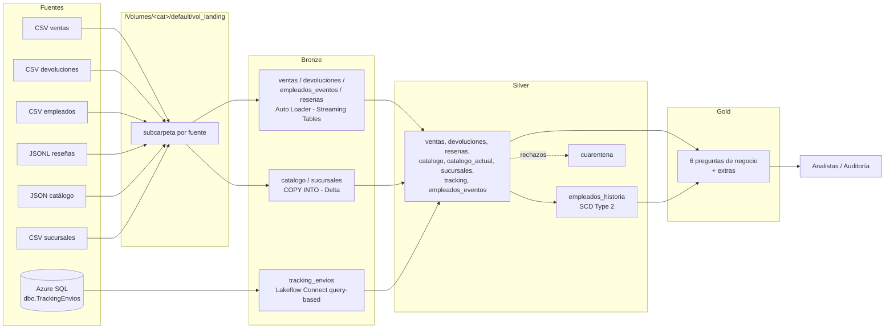
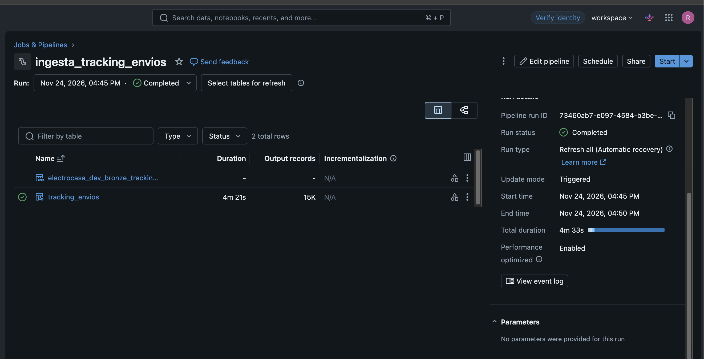
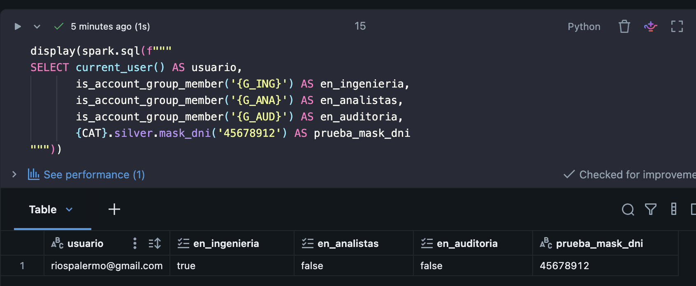
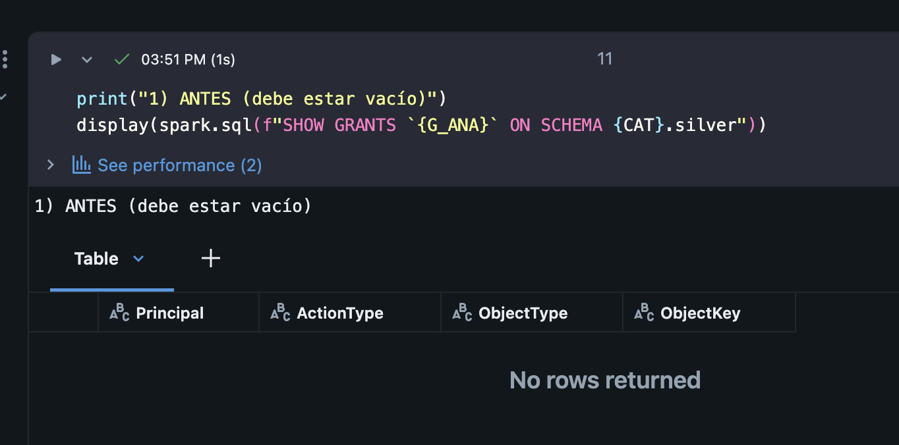
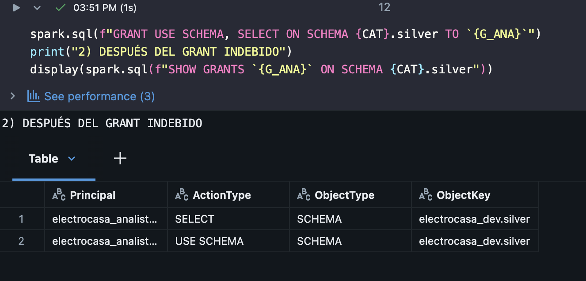
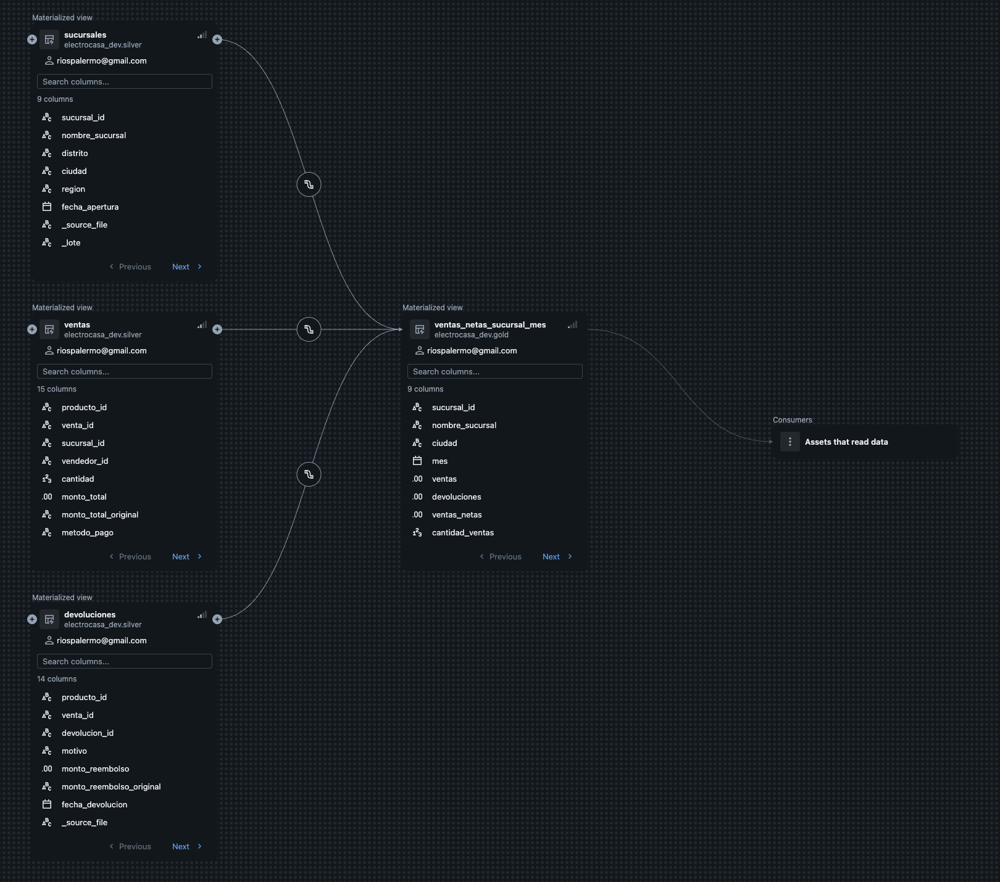
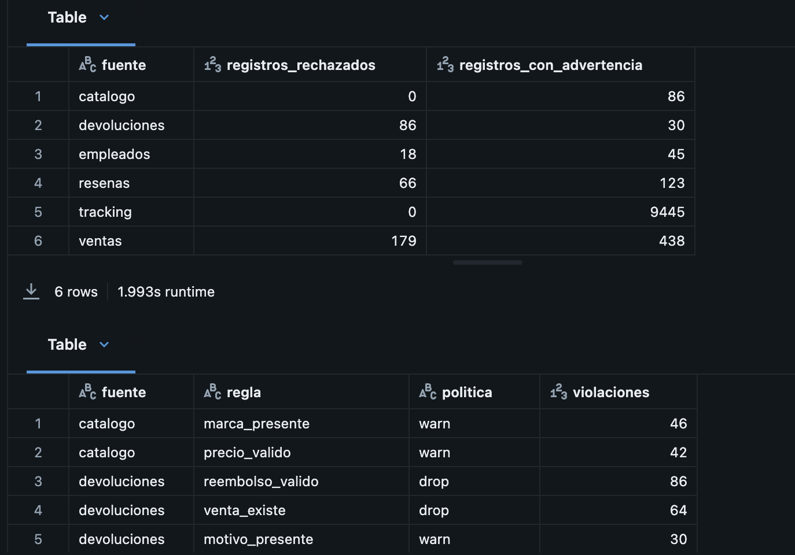
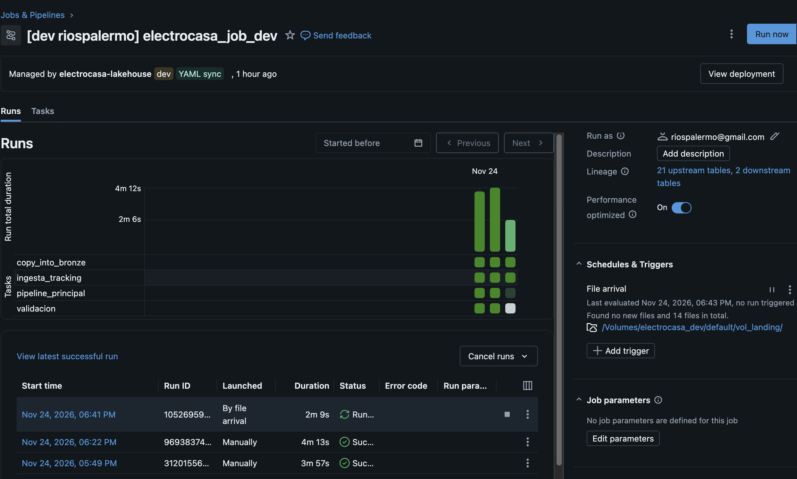

# ElectroCasa Lakehouse: proyecto integrador

Este repositorio es mi proyecto integrador del curso. Armé una plataforma de datos en Databricks Free Edition para ElectroCasa, una cadena ficticia de 40 sucursales de electrodomésticos en Perú. Junta seis fuentes (ventas, catálogo, RR.HH., reseñas, devoluciones y tracking de envíos) más la tabla de sucursales en un modelo Medallion. Las transformaciones están en Lakeflow Spark Declarative Pipelines, la orquestación en Lakeflow Jobs, los permisos en Unity Catalog y el despliegue en un Declarative Automation Bundle.

> Los datos, las sucursales y las personas son ficticios.

---

## 1. El caso

ElectroCasa no tiene una fuente única de verdad. Cada sucursal exporta sus ventas por su cuenta, RR.HH. registra los eventos en su propio sistema, las reseñas se leen a mano y el tracking está en la base del courier. La capa Gold responde seis preguntas para el período de marzo a octubre de 2026:

| # | Pregunta | Tabla Gold |
|---|---|---|
| 1 | Ventas netas, cantidad de ventas y ticket promedio por sucursal y mes | `gold.ventas_netas_sucursal_mes` |
| 2 | Top 10 por unidades y top 10 por tasa de devolución | `gold.top_productos_unidades`, `gold.top_productos_tasa_devolucion` |
| 3 | Dotación activa por sucursal al cierre de cada mes | `gold.dotacion_sucursal_mes` |
| 4 | Ventas de tienda física por vendedor, sucursal del vendedor en la fecha de la venta y mes | `gold.ventas_vendedor_sucursal_mes` |
| 5 | % de reseñas negativas por categoría y mes | `gold.resenas_negativas_categoria_mes` |
| 6 | Horas promedio de entrega y % de devueltos por courier | `gold.despachos_courier` |
| extra | Reseñas negativas por origen (VARIANT) | `gold.resenas_negativas_por_origen` |
| extra | Versión actual de empleados con masking | `gold.empleados_vista` |

---

## 2. Arquitectura



Orden de las tareas del job:

```
copy_into_bronze (notebook) ─┐
                             ├─► pipeline_principal (pipeline) ─► validacion (notebook)
ingesta_tracking (pipeline) ─┘
```

La ingesta de Tracking y el pipeline principal corren uno después del otro porque en Free Edition solo puede haber una pipeline activa por tipo.

### Estructura del repositorio

```
electrocasa-lakehouse/
├── databricks.yml                       # bundle: variables y targets dev / prod
├── resources/
│   ├── electrocasa_pipeline.yml         # pipeline Lakeflow SDP (serverless)
│   └── electrocasa_job.yml              # job: tareas, dependencias, trigger, reintentos y alertas
├── src/electrocasa/
│   ├── config/fuentes.json              # ingesta por metadata (rutas, formato, schema, opciones)
│   ├── transformations/
│   │   ├── 01_bronze.py                 # Auto Loader dirigido por fuentes.json
│   │   ├── 02_silver_referencia.py      # sucursales, catálogo, catálogo actual
│   │   ├── 03_silver_ventas.py          # ventas y devoluciones
│   │   ├── 04_silver_empleados.py       # eventos + SCD2 (con MASK)
│   │   ├── 05_silver_resenas.py         # reseñas (VARIANT)
│   │   ├── 06_silver_tracking.py        # tracking sin reprocesados
│   │   ├── 07_silver_cuarentena.py      # rechazos consultables
│   │   └── 08_gold.py                   # preguntas de negocio
│   └── utils/
│       ├── config.py                    # carga de fuentes.json, período, rangos
│       ├── normalizacion.py             # fechas, decimales, mapeos a conjuntos cerrados
│       ├── reglas.py                    # reglas de calidad (fuente de verdad de pipeline y contratos)
│       └── calidad.py                   # expectativas por política + constructor de cuarentena
├── contratos/                           # un contrato de datos por fuente
├── notebooks/
│   ├── 00_setup.ipynb                   # catálogo, schemas, volume, máscaras, GRANT / REVOKE
│   ├── 01_copy_into.ipynb               # COPY INTO idempotente (catálogo, sucursales)
│   ├── 02_validacion.ipynb              # conteos, rechazos y falla si Gold está vacío
│   └── 03_monitoreo_y_evidencias.ipynb  # event log, system tables, masking, SCD2, VARIANT
└── img/                                 # capturas de evidencia
```

---

## 3. Ingesta

### 3.1 Método por fuente

| Fuente | Método | Tabla Bronze | Por qué |
|---|---|---|---|
| Ventas | Auto Loader | `bronze.ventas` (ST) | Llega en lotes que solo agregan filas. Auto Loader recuerda qué archivos ya leyó. |
| Devoluciones | Auto Loader | `bronze.devoluciones` (ST) | Mismo caso que ventas. |
| Empleados | Auto Loader | `bronze.empleados_eventos` (ST) | Son eventos que solo se agregan, y algunos llegan tarde en lotes posteriores. |
| Reseñas | Auto Loader | `bronze.resenas` (ST) | JSON Lines anidado que llega por lotes. El schema explícito define los arreglos y structs. |
| Catálogo | COPY INTO | `bronze.catalogo` (Delta) | Es un snapshot completo que llega dos veces (marzo y agosto). Basta con cargar cada archivo una vez; no hace falta un stream. |
| Sucursales | COPY INTO | `bronze.sucursales` (Delta) | Es un solo archivo de referencia. Si se vuelve a ejecutar, COPY INTO no lo carga de nuevo. |
| Tracking | Lakeflow Connect (query-based, SQL Server) | `bronze.tracking_envios` | Lo pide el enunciado. Cursor `fecha_modificacion`, PK `evento_id`. |

Otras decisiones de Bronze:

- Todos los CSV se leen con schema explícito y todo como `STRING`. Los montos llegan con coma decimal y las fechas en varios formatos, así que la conversión la hago en Silver. No uso `inferSchema`.
- Cada tabla tiene columnas de auditoría: `_source_file` (sale de `_metadata.file_name`), `_source_path`, `_file_modification_ts`, `_lote` e `_ingest_ts`.
- Bronze no tiene lógica de negocio ni está particionado por fecha de negocio.
- Auto Loader corre dentro del pipeline, así que el pipeline maneja el checkpoint y la ubicación del schema. No configuré rutas a mano.
- COPY INTO corre fuera del pipeline, en la tarea `copy_into_bronze` del job. El pipeline lee esas tablas en batch desde materialized views.
- El catálogo se carga con `multiLine` y `primitivesAsString`. Sin esa segunda opción, COPY INTO falla con `DELTA_FAILED_TO_MERGE_FIELDS` porque `activo` llega como booleano.

### 3.2 Tracking (Lakeflow Connect)

1. Creé una Connection de Unity Catalog de tipo SQL Server, `conn_tracking_sqlserver`, con usuario y contraseña. La contraseña solo vive en la Connection.
2. El asistente creó además el catálogo foráneo `conn_tracking_sqlserver_catalog`, que usé solo para explorar la tabla.
3. Configuré la ingesta query-based sobre `dbo.TrackingEnvios`, con cursor `fecha_modificacion` y PK `evento_id`. No usé `tracking_id` como llave porque se repite por diseño. El destino es `electrocasa_dev.bronze.tracking_envios` y traigo solo `evento_id, tracking_id, venta_id, courier, estado_entrega, sucursal_origen, fecha_actualizacion, fecha_modificacion`.
4. Elegí el modo append only. Cada fila es un evento que no cambia después, así que no hay nada que actualizar. Con append quedan todos los eventos tal como llegaron, reprocesados incluidos, y la deduplicación la hago en Silver, donde se puede revisar.

Corridas de la pipeline `ingesta_tracking_envios` (update mode Triggered):

| Corrida | Inicio | Duración de la tabla | Output records `tracking_envios` |
|---|---|---|---|
| 1 (carga inicial) | 24-nov-2026 16:45 | 4m 21s | 15K (15.139 eventos) |
| 2 (sin cambios en la tabla) | 24-nov-2026 17:02 | 7s | 0 filas |

La segunda corrida no trae filas. El conector guarda el último `fecha_modificacion` que leyó y en la siguiente corrida solo pide registros con un valor mayor. Así se ve que la ingesta es incremental y no recarga todo.

Primera corrida, carga inicial:



Segunda corrida, sin filas nuevas:


`DESCRIBE HISTORY electrocasa_dev.bronze.tracking_envios` y conteo de la tabla:

| version | timestamp (UTC) | operation |
|---|---|---|
| 2 | 2026-11-24 21:50:14 | STREAMING UPDATE (carga de los 15.139 eventos, corrida 1) |
| 1 | 2026-11-24 21:45:51 | DLT SETUP |
| 0 | 2026-11-24 21:45:49 | CREATE TABLE |

```
SELECT count(*) AS eventos FROM electrocasa_dev.bronze.tracking_envios;  -->  15139
```

La corrida 2 (22:02 UTC) no generó una versión nueva: la última sigue siendo la 2 y la tabla tiene los mismos 15.139 eventos. La operación de carga es `STREAMING UPDATE` y no `MERGE`, lo que confirma que el conector quedó en append only.


---

## 4. Silver: limpieza, estandarización, deduplicación y calidad

Todas las tablas de Silver son materialized views sobre Bronze. Como se recalculan con todos los lotes, la deduplicación de reingestas sale exacta y los eventos tardíos de Empleados se ubican solos, sin lógica adicional.

| Normalización | Cómo |
|---|---|
| Fechas en varios formatos → `DATE`/`TIMESTAMP` | `coalesce` de `try_to_timestamp` con cada formato (no falla con ANSI) |
| `1.234,50` y `S/ 1,299.90` → `DECIMAL(12,2)` | detección de coma decimal vs. coma de miles (`utils/normalizacion.py`) |
| Métodos de pago, categorías, tipos de evento, estados, canal | mapeo por expresión regular a conjuntos cerrados |
| Courier | conjunto cerrado: `Olva Courier` (incluye "Olva"), `Shalom` y `Servientrega` |
| `ciudad` en sucursales | `initcap(lower(trim))` |
| Reingestas | ventas por `venta_id`, devoluciones por `devolucion_id`, reseñas por `resena_id` (queda la primera que llegó) |
| Productos repetidos en marzo | uno por producto y snapshot (precio válido y mayor) |
| Reprocesados de tracking | mismo `tracking_id` + estado + `fecha_actualizacion`: queda el de menor `fecha_modificacion` |

### 4.1 Expectativas de calidad y políticas

Las reglas están en un solo lugar, `src/electrocasa/utils/reglas.py`. De ahí salen las expectativas del pipeline (`dp.expect_all`, `expect_all_or_drop`, `expect_all_or_fail`) y también los contratos, así que contrato y código no pueden quedar desalineados.

| Fuente | Regla | Política | Por qué |
|---|---|---|---|
| Sucursales | `sucursal_id` no nulo | fail | Sucursal es la dimensión que conecta ventas, devoluciones, dotación y vendedores. Sin ella, todo Gold sale mal. Como es un archivo de referencia chico, prefiero detener el pipeline y corregir. |
| Ventas | `venta_id`, `fecha_venta`, `sucursal_id` presentes; `monto_total > 0`; `cantidad > 0`; canal válido | drop | Sin estos datos la venta no se puede asignar a una sucursal y un mes, ni sumar (P1, P2, P4). Se descarta la fila, no el lote. |
| Ventas | producto en catálogo, método de pago conocido, vendedor en tienda física | warn | La venta ocurrió igual. Sacarla bajaría las ventas netas sin razón. |
| Catálogo | `producto_id` presente | drop | Sin llave no hay producto. |
| Catálogo | `precio_lista` numérico > 0, categoría válida, marca presente | warn | Ninguna pregunta usa el precio. Si descartara el producto, sus reseñas quedarían excluidas como "producto inexistente". |
| Empleados | `id_empleado` y `fecha_evento` no nulos; `tipo_evento` válido | drop | Sin estos campos no se puede ubicar el evento en la historia. Declarar `NOT NULL` en el schema no lo impide; la que lo frena es la expectativa. |
| Empleados | salario en rango (500 a 30 000), dni único, dni presente | warn | No afectan la dotación ni las ventas por vendedor. |
| Reseñas | `calificacion` entera entre 1 y 5; `resena_id` y `fecha_resena` presentes | drop | P5 se calcula sobre la calificación. |
| Reseñas | producto en catálogo, comentario presente | warn | La reseña sigue siendo válida. P5 deja fuera los productos inexistentes con un `INNER JOIN`. |
| Devoluciones | venta existe; `0 <= monto_reembolso <= monto de la venta`; fecha y sucursal presentes | drop | La regla se evalúa sobre la vista que ya trae el join con ventas. Un reembolso inválido restaría ventas que no existen. |
| Tracking | estado dentro de {pendiente, en_transito, entregado, devuelto}; `tracking_id` y `fecha_modificacion` presentes | drop | P6 depende del estado y del tiempo entre estados. |
| Tracking | venta existe, `fecha_actualizacion` presente | warn | El tiempo de entrega del courier sirve igual. |

### 4.2 Cuarentena (`silver.cuarentena`)

La tabla guarda una fila por cada registro y regla que falló, con la fuente, la regla, la condición, la política, el id del registro, el lote, el archivo de origen, la fecha de ingesta, la fecha de proceso y el registro completo en JSON (sin `dni`, `salario` ni `email`). Las filas con `politica = 'drop'` son las rechazadas; las de `politica = 'warn'` siguen en Silver, pero quedan registradas. La cuarentena se recalcula desde Bronze en cada corrida: si corrijo un mapeo o una regla, los registros se reprocesan solos en la siguiente.

```sql
SELECT fuente, regla, politica, count(*) FROM electrocasa_dev.silver.cuarentena GROUP BY ALL;
```

### 4.3 Historización de Empleados (SCD Type 2)

No usé `AUTO CDC`. Armé los intervalos yo mismo sobre la tabla de eventos, en la materialized view `silver.empleados_historia`:

- Cada evento válido genera una versión. Los eventos se ordenan por `fecha_evento` (cuándo ocurrió) y, si dos caen el mismo día, por `fecha_registro` (cuándo lo cargó RR.HH.). Nunca uso `current_timestamp()` para ordenar.
- `vigente_desde` es la `fecha_evento` y `vigente_hasta` es la fecha del evento siguiente, sin incluirla. Si es `NULL`, es la versión actual.
- Si un evento no trae algún atributo (por ejemplo, el salario en una transferencia), se toma el de la versión anterior con `last(..., ignorenulls)`.
- `estado` es `ACTIVO` desde un alta, `CESADO` desde una baja o cese, y `SIN_ALTA` si nunca hubo alta.
- La vista se recalcula con todos los eventos, así que un evento de junio que llega en el lote 3 queda en su lugar y los intervalos vecinos se ajustan.

Elegí esto en lugar de `AUTO CDC` porque, con eventos tardíos y empates el mismo día, recalcular la historia completa da siempre el mismo resultado y es fácil de revisar. El orden sigue saliendo de columnas de la fuente.

Un caso real del empleado `EMP-00286` (salida de `03_monitoreo`, sección 7):

| versión | tipo_evento | sucursal | fecha_evento | fecha_registro | vigente_desde | vigente_hasta | actual |
|---|---|---|---|---|---|---|---|
| 1 | ALTA | S04 | 2024-10-26 | 2026-03-01 | 2024-10-26 | 2026-04-20 | no |
| 2 | TRANSFERENCIA | S32 | 2026-04-20 | 2026-04-24 | 2026-04-20 | 2026-06-08 | no |
| 3 | TRANSFERENCIA | S39 | 2026-06-08 | 2026-06-08 | 2026-06-08 | 2026-08-24 | no |
| 4 | TRANSFERENCIA | S06 | 2026-08-24 | 2026-10-11 | 2026-08-24 | 2026-09-25 | no |
| 5 | TRANSFERENCIA | S22 | 2026-09-25 | 2026-09-27 | 2026-09-25 | | sí |

La transferencia a S06 del 24 de agosto la cargó RR.HH. el 11 de octubre y llegó recién en el lote 3. Aun así quedó como versión 4, entre la de junio y la de septiembre, y cerró bien el intervalo anterior. Por eso, al cierre de agosto (P3), este empleado cuenta en S06 y no en S39.

En Gold, un empleado está activo en la fecha *d* si `estado = 'ACTIVO' AND vigente_desde <= d AND (vigente_hasta IS NULL OR vigente_hasta > d)`. Si la baja es el mismo día *d*, ese día ya no cuenta. En P4, si el vendedor no tiene una versión activa en la fecha de la venta, la venta va a `SIN_ASIGNAR`.

### 4.4 Decisiones

| Decisión | Elección | Por qué |
|---|---|---|
| Ventas con producto inexistente | Se conservan (warn, `producto_en_catalogo = false`) | La venta ocurrió; sacarla subestima P1. |
| Reseñas con producto inexistente | Se conservan en Silver (warn) y P5 las excluye | Así lo pide la pregunta, y Silver no pierde información. |
| Devoluciones con venta inexistente | Se descartan (drop, van a cuarentena) | No hay contra qué validar el reembolso ni se sabe a qué venta restarlo. |
| Tracking con venta inexistente | Se conserva (warn) | El tiempo del courier vale igual. |
| Mismo `dni` en dos empleados | Se conservan los dos, marcados con `dni_duplicado` (warn) | La llave es `id_empleado` y el dni no entra en ninguna pregunta. |
| Salarios fuera de rango | Se conservan, marcados con `salario_en_rango = false` (warn) | No afectan las preguntas y corregirlos le toca a RR.HH. |
| Máscara de `dni` | Últimos 3 dígitos visibles (`*****678`) | Deja verificar parcialmente sin mostrar el documento. |
| Máscara de `salario` | `NULL` | La función tiene que devolver `DECIMAL(12,2)`, así que no puede devolver `***`. |
| Conector de Tracking | Append only | Los eventos no cambian; deduplico en Silver. |
| Productos descontinuados | Se conservan con `activo = false` | Hay ventas y reseñas históricas que los referencian. |
| Auto Loader vs COPY INTO | Auto Loader: ventas, devoluciones, empleados, reseñas. COPY INTO: catálogo, sucursales | Ver 3.1. |

---

## 5. Gold

Las tablas de Gold se calculan sobre Silver y filtran el período 2026-03-01 a 2026-10-31.

- **P1.** Las ventas (por `fecha_venta`) y las devoluciones (por `fecha_devolucion`) se agregan por separado y después se unen con `FULL OUTER JOIN`, para que un mes con devoluciones pero sin ventas también aparezca. El ticket es ventas sin restar devoluciones, dividido por `COUNT(DISTINCT venta_id)`.
- **P2.** Unidades es `SUM(cantidad)`. La tasa es `COUNT(DISTINCT devolucion_id)` / `COUNT(DISTINCT venta_id)` del producto.
- **P3.** Calendario de cierres de mes cruzado con la historia SCD2. Incluye sucursales con 0 empleados.
- **P4.** Solo `tienda_fisica`, con join por rango de vigencia. Sin versión vigente, la venta va a `SIN_ASIGNAR`.
- **P5.** La categoría sale del último snapshot (`silver.catalogo_actual`). El `INNER JOIN` deja fuera los productos inexistentes; las calificaciones inválidas ya no llegan desde Silver.
- **P6.** Por envío, tomo el primer `pendiente` y el primer `entregado` según `fecha_modificacion`. El % de devueltos es envíos con algún `devuelto` sobre envíos con estado final.

---

## 6. Orquestación (Lakeflow Jobs)

El job está en `resources/electrocasa_job.yml`:

| Tarea | Tipo | Depende de | Reintentos |
|---|---|---|---|
| `copy_into_bronze` | notebook | (ninguna) | 2 (1 min) |
| `ingesta_tracking` | pipeline (conector) | (ninguna) | 2 (2 min) |
| `pipeline_principal` | pipeline | las dos anteriores | 1 |
| `validacion` | notebook | `pipeline_principal` | 0 (si falla, hay un problema real en los datos) |

El job se dispara por llegada de archivo a `/Volumes/<catalogo>/default/vol_landing/`. Los lotes no llegan con un calendario fijo, y correr por horario gastaría cuota sin datos nuevos. Con `wait_after_last_change_seconds: 120` y `min_time_between_triggers_seconds: 300`, los archivos de un mismo lote entran en una sola corrida. El estado del trigger lo maneja la variable `trigger_pausa` (`pause_status` explícito en el job): `UNPAUSED` en `dev` y `PAUSED` en `prod`, para no consumir la cuota de Free Edition.

Las alertas van por correo, en fallo y en éxito (`email_alertas`). Este correo llegó después de la corrida del lote 1 (run `3120155628384`, Succeeded):


`max_concurrent_runs: 1` evita que corran dos pipelines a la vez.

### Compute

| Recurso | Compute | Por qué |
|---|---|---|
| Pipeline principal | Serverless, modo triggered (no continuo) | Corre una vez por lote y los datos son chicos (decenas de miles de filas). No tiene sentido tener un cluster prendido, y el modo continuo en serverless está prohibido. |
| Conector Tracking | Serverless (lo administra Lakeflow Connect) | Es una ingesta incremental corta por cursor. |
| Notebooks del job (COPY INTO, validación) | Serverless jobs compute | Son tareas cortas que arrancan rápido. No uso clusters all-purpose en el job. |
| Consultas sueltas y evidencias | SQL warehouse 2X-Small o notebook serverless | Uso interactivo y de bajo consumo. |

---

## 7. Gobierno y seguridad (Unity Catalog)

Hay dos catálogos, `electrocasa_dev` y `electrocasa_prod`, con los schemas `bronze`, `silver` y `gold`, y el volume `default.vol_landing`. Todas las tablas son managed.

Creé los grupos desde Settings > Identity and access > Groups. Si se crean por API o SDK quedan como grupos locales del workspace y el `GRANT` falla con `PRINCIPAL_DOES_NOT_EXIST`.

| Grupo | Permisos (`notebooks/00_setup.ipynb`) |
|---|---|
| `electrocasa_ingenieria` | `USE CATALOG`; `USE SCHEMA, SELECT, MODIFY, CREATE TABLE, CREATE MATERIALIZED VIEW, CREATE FUNCTION, EXECUTE` en bronze/silver/gold; `READ/WRITE VOLUME` en landing |
| `electrocasa_analistas` | `USE CATALOG`; `USE SCHEMA, SELECT` en gold |
| `electrocasa_auditoria` | `USE CATALOG`; `USE SCHEMA, SELECT` en gold; tablas de sistema (ver más abajo) |

Salida de la sección 3 de `00_setup` sobre `electrocasa_dev`. Ningún `GRANT` falló, así que Unity Catalog reconoce los tres grupos:

```
OK  GRANT USE CATALOG ON CATALOG electrocasa_dev TO `electrocasa_ingenieria`
OK  GRANT USE SCHEMA, SELECT, MODIFY, CREATE TABLE, CREATE MATERIALIZED VIEW, CREATE FUNCTION, EXECUTE ON SCHEMA electrocasa_dev.bronze TO `electrocasa_ingenieria`
OK  GRANT USE SCHEMA, SELECT, MODIFY, CREATE TABLE, CREATE MATERIALIZED VIEW, CREATE FUNCTION, EXECUTE ON SCHEMA electrocasa_dev.silver TO `electrocasa_ingenieria`
OK  GRANT USE SCHEMA, SELECT, MODIFY, CREATE TABLE, CREATE MATERIALIZED VIEW, CREATE FUNCTION, EXECUTE ON SCHEMA electrocasa_dev.gold TO `electrocasa_ingenieria`
OK  GRANT USE SCHEMA ON SCHEMA electrocasa_dev.default TO `electrocasa_ingenieria`
OK  GRANT READ VOLUME, WRITE VOLUME ON VOLUME electrocasa_dev.default.vol_landing TO `electrocasa_ingenieria`
OK  GRANT USE CATALOG ON CATALOG electrocasa_dev TO `electrocasa_analistas`
OK  GRANT USE SCHEMA, SELECT ON SCHEMA electrocasa_dev.gold TO `electrocasa_analistas`
OK  GRANT USE CATALOG ON CATALOG electrocasa_dev TO `electrocasa_auditoria`
OK  GRANT USE SCHEMA, SELECT ON SCHEMA electrocasa_dev.gold TO `electrocasa_auditoria`
```

Yo despliego el bundle y soy dueño del pipeline. Estoy en `electrocasa_ingenieria` y no en los otros dos grupos, y la máscara me devuelve el DNI completo:



### REVOKE

Le di a `electrocasa_analistas` un permiso que no le corresponde (`USE SCHEMA` + `SELECT` sobre `electrocasa_dev.silver`), revisé que apareciera y lo revoqué.

Antes, `SHOW GRANTS` no devuelve filas porque analistas no tiene acceso a silver:



Después del GRANT indebido aparecen `SELECT` y `USE SCHEMA` sobre `electrocasa_dev.silver`:



Después del REVOKE, `SHOW GRANTS` vuelve a salir vacío:


### Auditoría y tablas de sistema

Intenté darle a `electrocasa_auditoria` `USE CATALOG` sobre `system`, `USE SCHEMA` sobre `system.access` y `SELECT` sobre `audit`, `table_lineage` y `column_lineage` (sección 5 de `00_setup`). En Free Edition los cinco fallan porque ni el administrador del workspace tiene `MANAGE` sobre el catálogo `system`:

```
ERROR  GRANT USE CATALOG ON CATALOG system TO `electrocasa_auditoria`
       (com.databricks.sql.managedcatalog.acl.UnauthorizedAccessException) PERMISSION_DENIED: User does not have MANAGE on Catalog 'system'.
ERROR  GRANT USE SCHEMA ON SCHEMA system.access TO `electrocasa_auditoria`
       (com.databricks.sql.managedcatalog.acl.UnauthorizedAccessException) PERMISSION_DENIED: User does not have MANAGE on Schema 'system.access'.
ERROR  GRANT SELECT ON TABLE system.access.audit TO `electrocasa_auditoria`
       (com.databricks.sql.managedcatalog.acl.UnauthorizedAccessException) PERMISSION_DENIED: User does not have MANAGE on Table 'system.access.audit'.
ERROR  GRANT SELECT ON TABLE system.access.table_lineage TO `electrocasa_auditoria`
       (com.databricks.sql.managedcatalog.acl.UnauthorizedAccessException) PERMISSION_DENIED: User does not have MANAGE on Table 'system.access.table_lineage'.
ERROR  GRANT SELECT ON TABLE system.access.column_lineage TO `electrocasa_auditoria`
       (com.databricks.sql.managedcatalog.acl.UnauthorizedAccessException) PERMISSION_DENIED: User does not have MANAGE on Table 'system.access.column_lineage'.
```

Como alternativa, Auditoría tiene `SELECT` sobre gold y el lineage queda documentado con la pestaña Lineage de Catalog Explorer:



En el grafo de `gold.ventas_netas_sucursal_mes` se ven sus tres orígenes en Silver (`silver.sucursales`, `silver.ventas` y `silver.devoluciones`, todas materialized views del pipeline), el pipeline que las conecta y quién consume la tabla. Cada nodo muestra el dueño (`riospalermo@gmail.com`) y las columnas, así que Auditoría puede seguir una cifra de Gold hasta su tabla de origen.

### Masking

`dni` y `salario` tienen `MASK` declarado en el schema de las tablas del pipeline (`silver.empleados_eventos`, `silver.empleados_historia` y `gold.empleados_vista`). Las funciones `silver.mask_dni` y `silver.mask_salario` usan `is_account_group_member('electrocasa_ingenieria')`.

Como el dueño del pipeline está en `electrocasa_ingenieria`, la tabla derivada `gold.empleados_vista` guarda los valores reales y la máscara se aplica al consultar. Esto lo consulté como `riospalermo@gmail.com`, con `en_ingenieria = true` (sección 6 de `03_monitoreo`):

```
silver.empleados_historia  ->  EMP-00001 | Gabriela Mamani | dni 22108722 | salario 2269.90 | S37
gold.empleados_vista       ->  EMP-00004 | Daniela Gutierrez | dni 48867538 | salario 1532.42 | S19
```

`DESCRIBE TABLE EXTENDED electrocasa_dev.gold.empleados_vista` muestra las máscaras que declaré en el pipeline:

```
# Column Masks
dni       `electrocasa_dev`.`silver`.`mask_dni`
salario   `electrocasa_dev`.`silver`.`mask_salario`
Type      MATERIALIZED_VIEW
Owner     riospalermo@gmail.com
```

Para alguien fuera de `electrocasa_ingenieria`, `mask_dni` devuelve `*****722` y `mask_salario` devuelve `NULL`, como se ve en la prueba de la función en `00_setup`.

> Si no se hubieran podido crear los grupos, la función compararía con `current_user() = '<correo>'` (está comentado en `00_setup`).

---

## 8. CI/CD (Declarative Automation Bundle)

`databricks.yml` está en la raíz y los recursos en `resources/`. Hay dos targets en el mismo workspace, separados por catálogo:

- `dev` usa `electrocasa_dev`, en modo development, con el trigger activo (`pause_status: UNPAUSED` explícito).
- `prod` usa `electrocasa_prod`, en modo production, con el trigger pausado y `run_as` explícito.

### Pasos de despliegue

1. Crear los 3 grupos desde la UI y agregarse a `electrocasa_ingenieria`.
2. Ejecutar `notebooks/00_setup.ipynb` con `catalogo = electrocasa_dev`, y después con `electrocasa_prod`.
3. Crear la Connection y la ingesta de Tracking (sección 3.2) y copiar el ID de esa pipeline.
4. Completar `email_alertas` y `tracking_pipeline_id` en `databricks.yml` (o pasarlos con `--var`).
5. Desplegar:
   ```bash
   databricks bundle validate -t dev
   databricks bundle deploy -t dev
   ```
   También se puede desde el panel Deployments del Git Folder, que es lo que usé.
6. Subir el lote 1 al volume, junto con el snapshot de marzo y `sucursales.csv`. Esperar el trigger o correr `databricks bundle run electrocasa_job -t dev`.
7. Anotar los conteos que muestra la tarea `validacion` y repetir con los lotes 2 y 3.

Salida del deploy del target `dev`:

```
[11/24/2026, 5:30:27 PM] Running "deploy" on "dev" target
Source-linked deployment is enabled. Deployed resources reference the source files in your working tree instead of separate copies.
Created pipelines.electrocasa_pipeline
Created jobs.electrocasa_job
Files: 0 uploaded, 0 deleted
Resources: 2 created, 0 changed, 0 deleted, 0 unchanged
[11/24/2026, 5:30:31 PM] Finished "deploy" on "dev" target successfully
```

Quedaron creados `[dev riospalermo] electrocasa_job_dev` y `[dev riospalermo] electrocasa_pipeline_dev`.


> El primer intento falló con `target with 'mode: development' cannot set trigger pause status to UNPAUSED by default`. En modo development no se pueden activar los triggers con `presets.trigger_pause_status`, así que pasé a declarar `pause_status` directamente en el trigger del job, con la variable `trigger_pausa`.

---

## 9. Ejecución por lote

Los conteos salen de `02_validacion` después de cada lote. En Bronze, los tres lotes coinciden exactamente con los volúmenes del README de datos.

### Bronze

| Tabla | Lote 1 | Lote 2 | Lote 3 |
|---|---|---|---|
| bronze.ventas | 6.783 | 13.622 | 18.240 |
| bronze.devoluciones | 1.387 | 3.091 | 4.217 |
| bronze.empleados_eventos | 2.257 | 3.524 | 4.448 |
| bronze.resenas | 5.292 | 9.280 | 9.280 (sin lote 3) |
| bronze.catalogo | 2.305 | 4.705 | 4.705 (sin snapshot nuevo) |
| bronze.sucursales | 40 | 40 | 40 |
| bronze.tracking_envios | 15.139 | 15.139 | 15.139 |

### Silver

| Tabla | Lote 1 | Lote 2 | Lote 3 |
|---|---|---|---|
| silver.ventas | 6.604 | 13.118 | 17.488 |
| silver.devoluciones | 1.301 | 2.877 | 3.908 |
| silver.empleados_eventos | 2.239 | 3.495 | 4.410 |
| silver.empleados_historia | 2.239 | 3.495 | 4.410 |
| silver.resenas | 5.226 | 9.097 | 9.097 |
| silver.catalogo / catalogo_actual | 2.280 / 2.280 | 4.680 / 2.400 | 4.680 / 2.400 |
| silver.sucursales | 40 | 40 | 40 |
| silver.tracking | 15.052 | 15.052 | 15.052 |

### Gold

| Tabla | Lote 1 | Lote 2 | Lote 3 |
|---|---|---|---|
| gold.ventas_netas_sucursal_mes | 120 (40 sucursales × mar-may) | 240 (40 × mar-ago) | 320 (40 × mar-oct) |
| gold.top_productos_unidades | 10 | 10 | 10 |
| gold.top_productos_tasa_devolucion | 10 | 10 | 10 |
| gold.dotacion_sucursal_mes | 320 (40 sucursales × 8 cierres de mes) | 320 | 320 |
| gold.ventas_vendedor_sucursal_mes | 2.009 | 4.078 | 5.502 |
| gold.resenas_negativas_categoria_mes | 25 | 40 (5 categorías × 8 meses) | 40 |
| gold.despachos_courier | 4 | 4 | 4 |
| gold.resenas_negativas_por_origen | 3 | 3 | 3 |
| gold.empleados_vista | 1.220 | 1.414 | 1.499 |

`gold.despachos_courier` da 4 en estas tres corridas porque "Olva" y "Olva Courier" todavía salían como couriers distintos. Más abajo explico el ajuste.

### Rechazados por fuente (`politica = 'drop'`)

| Fuente | Lote 1 | Lote 2 | Lote 3 |
|---|---|---|---|
| ventas | 179 | 384 | 512 |
| devoluciones | 86 | 184 | 249 |
| empleados | 18 | 29 | 38 |
| resenas | 66 | 103 | 103 |
| catalogo | 0 | 0 | 0 |
| tracking | 0 | 0 | 0 |

### Lote 1

Bronze coincide con el README de datos en las 7 tablas, y Silver cuadra con los rechazados:

- devoluciones: 1.387 − 86 = 1.301
- empleados: 2.257 − 18 = 2.239
- reseñas: 5.292 − 66 = 5.226
- ventas: 6.783 − 179 = 6.604

El catálogo pasa de 2.305 a 2.280 porque los 25 productos repetidos del snapshot de marzo quedan una sola vez. En tracking, los 15.139 eventos quedan en 15.052 al sacar 87 mensajes reprocesados. No hay rechazos de tracking, pero sí muchas advertencias `venta_existe`: los envíos apuntan a ventas de lotes que todavía no habían llegado.




Violaciones por regla en el lote 1:

| Fuente | Regla | Política | Violaciones |
|---|---|---|---|
| ventas | monto_positivo | drop | 127 |
| ventas | sucursal_presente | drop | 32 |
| ventas | cantidad_positiva | drop | 22 |
| ventas | metodo_pago_conocido | warn | 416 |
| ventas | producto_en_catalogo | warn | 23 |
| devoluciones | reembolso_valido | drop | 86 |
| devoluciones | venta_existe | drop | 64 |
| devoluciones | motivo_presente | warn | 30 |
| empleados | fecha_evento_presente | drop | 18 |
| empleados | dni_presente | warn | 28 |
| empleados | dni_unico | warn | 18 |
| empleados | salario_en_rango | warn | 8 |
| resenas | calificacion_valida | drop | 66 |
| resenas | comentario_presente | warn | 62 |
| resenas | producto_en_catalogo | warn | 61 |
| catalogo | marca_presente | warn | 46 |
| catalogo | precio_valido | warn | 42 |
| tracking | venta_existe | warn | 9.321 |
| tracking | fecha_actualizacion_presente | warn | 285 |

`tipo_evento_valido`, `categoria_valida`, `estado_valido` y `canal_valido` no tuvieron ninguna violación, así que los mapeos cubren todas las formas de escribir esos campos que aparecen en Bronze.

Job del lote 1 (run `3120155628384`, 3m 57s, las 4 tareas en verde):


### Dos ajustes que salieron de mirar los datos

Las 416 advertencias de `metodo_pago_conocido` venían todas de una variante que no tenía mapeada: `TRF` (402 filas en Silver; el resto también caía por otra regla). Agregué `^trf$` al patrón de `transferencia` en `utils/normalizacion.py` y actualicé el contrato de ventas. Desde el lote 2, esa advertencia queda en 0.

Al final, la consulta de couriers en Bronze mostró que `Olva` y `Olva Courier` son el mismo courier escrito de dos formas. Solo unificando mayúsculas, P6 mostraba 4 couriers. Agregué el conjunto cerrado `COURIERS` en `utils/normalizacion.py` y P6 queda con 3: Olva Courier, Shalom y Servientrega.

### Lote 2

Bronze vuelve a coincidir con el README de datos. Acá ya se ve la deduplicación de reingestas:

| Fuente | Filas Bronze | IDs distintos Bronze | Filas Silver |
|---|---|---|---|
| ventas | 13.622 | 13.502 (120 ventas reingresadas) | 13.118 = 13.502 − 384 rechazadas |
| devoluciones | 3.091 | 3.061 (30 reingresadas) | 2.877 = 3.061 − 184 |
| reseñas | 9.280 | 9.200 (80 reingresadas) | 9.097 = 9.200 − 103 |
| tracking | 15.139 | 15.139 | 15.052 (87 reprocesados) |

Las filas repetidas entran a Bronze, que solo agrega, pero en Silver quedan una sola vez. En el catálogo, `silver.catalogo` tiene 2.280 versiones de marzo más 2.400 de agosto (4.680), y `catalogo_actual` tiene los 2.400 productos con la categoría del último snapshot. La advertencia `metodo_pago_conocido` desapareció con el mapeo de `TRF`, y `tracking.venta_existe` bajó de 9.321 a 3.946 porque ya habían llegado las ventas de junio a agosto.

### Lote 3

Esta corrida la lanzó el trigger. Subí los 3 archivos del lote 3 (ventas, empleados y devoluciones) con el trigger activo. El trigger vio el cambio (14 archivos en total), esperó los 120 s de `wait_after_last_change_seconds` y lanzó el job a las 18:41, con "Launched: By file arrival".

Los lotes 1 y 2 los lancé a mano. El 2 lo subí con el trigger pausado y, al reactivarlo, el trigger tomó esos archivos como punto de partida y no disparó. Es el caso que el enunciado ya anticipa.




| Fuente | Filas Bronze | IDs distintos Bronze | Filas Silver |
|---|---|---|---|
| ventas | 18.240 | 18.000 (240 reingresadas en total) | 17.488 = 18.000 − 512 |
| devoluciones | 4.217 | 4.157 (60 reingresadas) | 3.908 = 4.157 − 249 |
| reseñas | 9.280 | 9.200 | 9.097 |
| tracking | 15.139 | 15.139 | 15.052 |

`empleados_eventos` queda en 4.448 − 38 = 4.410 eventos, y la historia SCD2 tiene 4.410 versiones. Los eventos de junio a agosto que RR.HH. registró tarde se ubican por `fecha_evento`, no por el lote en que llegaron (el ejemplo de `EMP-00286` está en 4.3). `gold.ventas_netas_sucursal_mes` ya cubre los 8 meses: 40 × 8 = 320.

`tracking.venta_existe` pasó de 9.321 a 3.946 y después a 415. Con todas las ventas cargadas, solo quedan los envíos cuya venta de verdad no existe en la fuente.

En resumen: Bronze crece con cada lote porque incluye las reingestas, mientras que `silver.ventas`, `silver.devoluciones` y `silver.resenas` solo crecen con IDs nuevos.

---

## 10. Monitoreo

Todo esto sale de `notebooks/03_monitoreo_y_evidencias.ipynb`, que ejecuté después del lote 3.

### 10.1 Event log del pipeline

Consulté `event_log(TABLE(electrocasa_dev.silver.ventas))`. Hay una actualización por lote, todas lanzadas por `JOB_TASK` y terminadas en `COMPLETED`:

| Update | Inicio (UTC) | Fin (UTC) | Estado |
|---|---|---|---|
| `6b6226` (lote 1) | 22:50:35 | 22:52:35 | COMPLETED |
| `665be1` (lote 2) | 23:23:34 | 23:26:01 | COMPLETED |
| `ccb1e6` (lote 3) | 23:41:54 | 23:44:18 | COMPLETED |

Cada actualización pasa por `WAITING_FOR_RESOURCES → INITIALIZING → SETTING_UP_TABLES → RUNNING → COMPLETED`.

El event log también guarda las métricas de cada expectativa (`details:flow_progress:data_quality`). Están acumuladas en todas las actualizaciones; este es un extracto:

| Tabla | Expectativa | Filas OK | Filas fallidas |
|---|---|---|---|
| silver.ventas | monto_positivo | 37.550 | 735 |
| silver.ventas | sucursal_presente | 38.074 | 211 |
| silver.ventas | cantidad_positiva | 38.142 | 143 |
| silver.devoluciones | reembolso_valido | 8.086 | 519 |
| silver.devoluciones | venta_existe | 8.218 | 387 |
| silver.empleados_eventos | fecha_evento_presente | 10.144 | 85 |
| silver.resenas | calificacion_valida | 23.420 | 272 |
| silver.tracking | estado_valido | 45.156 | 0 |
| silver.sucursales | sucursal_id_presente (fail) | 120 | 0 |

### 10.2 Historial de corridas (`system.lakeflow.job_run_timeline`)

En este workspace `system.lakeflow` sí está disponible. Para sacar las corridas del job lo crucé con `system.lakeflow.jobs`, tomando la última versión de cada job:

| Run | Inicio (UTC) | Fin (UTC) | Resultado |
|---|---|---|---|
| `3120155628384` (lote 1) | 22:49:42 | 22:53:39 | SUCCEEDED |
| `969383745965523` (lote 2) | 23:22:48 | 23:27:00 | SUCCEEDED |
| lote 3 (file arrival) | 23:41 | | SUCCEEDED en la pestaña Runs; todavía no aparecía en las tablas de sistema, que tienen latencia |

### 10.3 Costos (`system.billing.usage`)

La tabla está disponible, pero cuando la consulté solo mostraba `DEFAULT_STORAGE` (0,0125 DBU). En Free Edition el consumo de serverless aparece varias horas después. La consulta quedó en el notebook para volver a correrla.

---

## 11. Retos opcionales

| Reto | Dónde |
|---|---|
| Ingesta por metadata | `src/electrocasa/config/fuentes.json`. Las tablas de Bronze con Auto Loader y las cargas con COPY INTO se arman a partir de ese archivo; para sumar una fuente basta con agregar una entrada. |
| Cuarentena con trazabilidad completa | `silver.cuarentena`, con fuente, regla, lote, archivo, fechas y el registro en JSON. Si corrijo una regla, los registros se reprocesan en la siguiente corrida. |
| VARIANT en Reseñas | `metadata` pasa a `VARIANT` en Silver con `try_parse_json`. Con `schema_of_variant_agg` vi la estructura real: `OBJECT<app: OBJECT<so, version>, campania: OBJECT<codigo, cupon_usado>, kiosko_id, navegador, origen, sucursal_id>`. `gold.resenas_negativas_por_origen` usa `metadata:origen`, `metadata:app.so` y `metadata:app.version`. Reseñas negativas: 17,89 % en app, 16,97 % en web y 16,54 % en tienda. |
| Costos medidos | Consulta a `system.billing.usage` en `03_monitoreo`. La tabla está disponible, pero el consumo serverless aparece con retraso (ver 10.3). |

---

## 12. Antipatrones que evité

- No hay credenciales en el código; la contraseña vive en la Connection de Unity Catalog.
- No hay checkpoints en `/tmp`, porque los maneja el pipeline.
- Uso `_metadata.file_name` en vez de `input_file_name()`.
- Todos los CSV tienen schema explícito, sin `inferSchema`.
- Bronze no está particionado por fecha de negocio ni tiene lógica de negocio.
- No uso `trigger(once=True)` ni pipelines continuos.
- El job no usa clusters all-purpose.
- No uso `dbutils.fs.mount` ni `outputMode("complete")`.
- La historia de empleados no se ordena con `current_timestamp()`.
